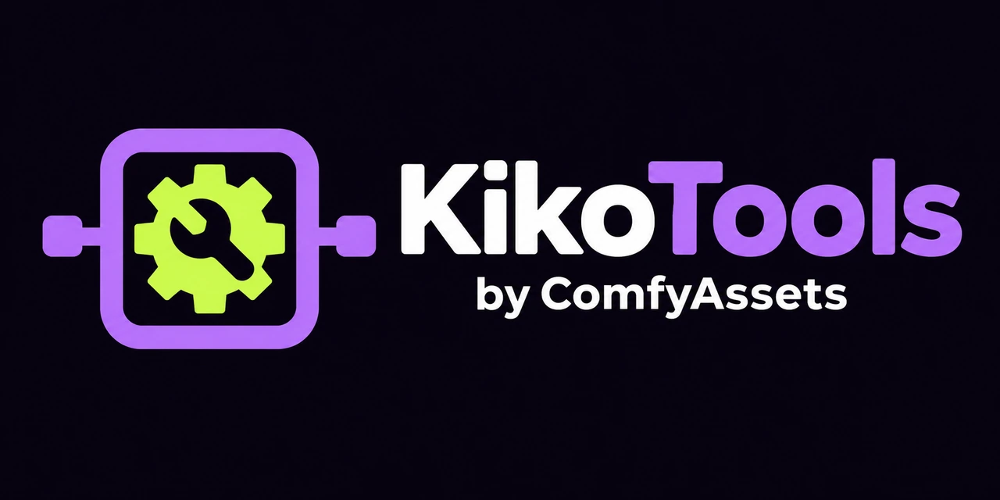

# ComfyUI-KikoTools


> A modular collection of essential custom ComfyUI nodes missing from the standard release.

ComfyUI-KikoTools provides carefully crafted, production-ready nodes under the "ComfyAssets" category.
Each tool is built with clean interfaces, thorough testing, and optimized performance for SDXL and FLUX workflows.

This project started out of frustration with keeping ComfyUI up to date and waiting for dozens of custom nodes to update—most of which I didn’t even use. After taking a hard look at my workflow, I realized I only needed one or two features from these nodes, many of which were abandoned or stuck in maintenance mode.

I tried forking, patching, and submitting merge requests, but eventually decided to create my own curated collection of tools—fully supported and maintained by me. That’s how Kiko’s Tools was born.

I’m sharing them here with the community, and I hope you find them as useful as I do.

## 1.9.0: MiniMax H3 Image sizes

The [Model Resolution Picker](#-model-resolution-picker) has a new
`MiniMax H3 Image` family with 1K, 2K and 4K sizes for every ratio chip, all on
the model's 32-pixel grid and defaulting to 2048×2048. See the
[release notes](CHANGELOG.md).

## 1.8.0: refs for MiniMax H3

Ctrl-click photos in the [Local Image Loader](#-local-image-loader) gallery to pick
them in order. The new `refs` output feeds them to Create H3 RefMod in
ComfyUI-MiniMaxH3Mod, every photo matched to the first photo's size, and
`refs_preview` shows what Create H3 RefMod will encode. The
[Kiko Prompt Enhancer](#-kiko-prompt-enhancer) now writes full prompts with the
Qwen3-VL 4B and 8B text encoders. See the [release notes](CHANGELOG.md).

## 1.7.0 — Model sweeps

Compare every model in a folder with the settings each one was made for. The new
[Model Recommended Settings](#-model-recommended-settings) node reads a model's
recommended steps, CFG, sampler and scheduler from the Civitai info LoRA Manager
already stored, with substitutes for schedulers you don't have installed.
[Checkpoint Folder Iterator](#-checkpoint-folder-iterator) can now sweep
`models/diffusion_models` (MOSS, Flux and other split models), and
[Model Compare Sheet](#-model-compare-sheet) starts a new grid when the prompt or
settings change mid-sweep. See the [release notes](CHANGELOG.md).

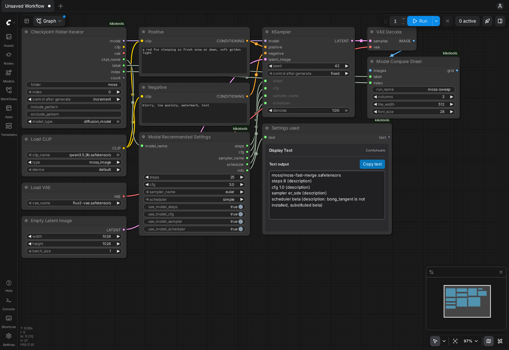

## 1.6.0 — Kiko Prompt Enhancer

A new node that rewrites a short prompt in the style each base model was trained
on (SDXL realism, Illustrious, Anima, Flux.2 Klein, Z-Image, MOSS, Krea 2,
Qwen-Image 2.1, Wan T2V/I2V). Pick the LLM that does the rewriting from your local
text encoders or GGUF models, use `text` or `vision` mode, and keep LoRA trigger
words exactly as typed. The system prompts are plain Markdown files you can
override per model. See the [node documentation](#-kiko-prompt-enhancer) and the
[release notes](CHANGELOG.md).

## 1.3.0 — Model Resolution Picker

A new node that picks a native resolution for a model family from a chip grid of
aspect ratios, with a synced `resolution` dropdown, a shipped family table and a
user override file. See the [release notes](CHANGELOG.md) and the
[node documentation](examples/documentation/model_resolution_picker.md).

## 1.2.0 — unified ComfyAssets UI

A consistent interface across the KikoTools controls, with ComfyUI-following
light/dark styling and Classic/Nodes 2.0 support. Existing workflow interfaces
and settings are retained. See the [release notes](CHANGELOG.md),
[migration overview](docs/ui-migration.md) and [screenshots](docs/screenshots/).

## ComfyUI Classic and Nodes 2.0

KikoTools supports both ComfyUI Classic and Nodes 2.0. Our shared ComfyAssets
controls follow ComfyUI's dark/light theme, with automated tests covering renderer
switching, workflow persistence and cleanup. See the retained
[UI screenshots](docs/screenshots/) for examples from the migrations.

## 🚀 Features

### ✨ Current Tools

| Tool | Description | Category |
|------|-------------|----------|
| [📐 Resolution Calculator](#-resolution-calculator) | Calculate upscaled dimensions with model optimization | 🖼️ Resolution |
| [📏 Width Height Selector](#-width-height-selector) | Preset-based dimension selection with visual swap | 🖼️ Resolution |
| [🎲 Seed History](#-seed-history) | Advanced seed tracking with interactive history | 🌱 Seeds |
| [⚙️ Sampler Combo](#️-sampler-combo) | Unified sampling configuration interface | 🌀 Samplers |
| [🧭 Model Recommended Settings](#-model-recommended-settings) | Steps, CFG, sampler and scheduler from a model's Civitai info | 🌀 Samplers |
| [📦 Empty Latent Batch](#-empty-latent-batch) | Create empty latent batches with preset support | 📦 Latents |
| [🎯 Model Resolution Picker](#-model-resolution-picker) | Pick a model family and size from ratio chips, with latent and width/height outputs | 🖼️ Resolution |
| [💾 Kiko Save Image](#-kiko-save-image) | Enhanced image saving with popup viewer | 💾 Images |
| [📋 Display Text](#-display-text) | Smart text display with prompt detection | 👁️ Display |
| [🤖 Gemini Prompt Engineer](#-gemini-prompt-engineer) | Deprecated; retained for existing workflows | 🧠 Prompts |
| [🔍 Display Any](#-display-any) | Universal debugging tool for any data type | 👁️ Display |
| [🖼️ Image to Multiple Of](#️-image-to-multiple-of) | Adjust dimensions to multiples for compatibility | 🖼️ Resolution |
| [📉 Image Scale Down By](#-image-scale-down-by) | Scale images down by a factor with quality preservation | 🖼️ Resolution |
| [🎬 Film Grain](#-film-grain) | Add realistic film grain effects to images | 💾 Images |
| [🔤 Embedding Autocomplete](#-embedding-autocomplete) | Smart autocomplete for embeddings, LoRAs, and tags | 🔧 Utils |
| [🧹 Kiko Purge VRAM](#-kiko-purge-vram) | Free GPU memory between workflow stages: unload models, return the cache, or both | 🛠️ Utils |
| [📂 Local Image Loader](#-local-image-loader) | Gallery that loads a local image, a folder path, or ordered refs for MiniMax H3 | 💾 Images |
| [🌐 Model Downloader](#-model-downloader) | Download models from CivitAI, HuggingFace, and custom URLs | 🛠️ Utils |
| [🧠 Kiko Prompt Enhancer](#-kiko-prompt-enhancer) | Rewrite a short prompt in a base model's style with the loaded text encoder | 🧠 Prompts |
| [🫶 H3 Reference Prompter](#-h3-reference-prompter) | Write one long MiniMax H3 prompt from a short draft and up to three reference pictures | 🧠 Prompts |
| [⏱️ Workflow Timer](#️-workflow-timer) | Real-time execution timer with customizable display | 🛠️ Utils |
| [🗂️ Project File Path](#️-project-file-path) | Build safe, organized save prefixes like `MyProject/images/image` | 🛠️ Utils |

### 🧰 xyz-helpers Tools

Advanced parameter management tools adapted from [comfyui-essentials-nodes](https://github.com/cubiq/ComfyUI_essentials) (now in maintenance mode):

| Tool | Description | Category |
|------|-------------|----------|
| [🎛️ Flux Sampler Params](#️-flux-sampler-params) | FLUX-optimized parameter generator with batch support | 🧰 xyz-helpers |
| [📁 LoRA Folder Batch](#-lora-folder-batch) | Batch process multiple LoRAs from folders | 🧰 xyz-helpers |
| [🔁 Checkpoint Folder Iterator](#-checkpoint-folder-iterator) | Load one checkpoint per queued run from a folder | 🧰 xyz-helpers |
| [🧩 Model Compare Sheet](#-model-compare-sheet) | Save each run's image and rebuild a labeled contact sheet | 🧰 xyz-helpers |
| [📊 Plot Parameters](#-plot-parameters) | Visualize parameter effects with graphs | 🧰 xyz-helpers |
| [🎯 Sampler Select Helper](#-sampler-select-helper) | Intelligent sampler selection with recommendations | 🧰 xyz-helpers |
| [📅 Scheduler Select Helper](#-scheduler-select-helper) | Optimal scheduler selection for samplers | 🧰 xyz-helpers |
| [✍️ Text Encode Sampler Params](#️-text-encode-sampler-params) | Combined text encoding and parameter management | 🧰 xyz-helpers |

#### 📐 Resolution Calculator
Calculate upscaled dimensions from image or latent inputs with precision.

- **Smart Input Handling**: Works with both IMAGE and LATENT tensors
- **Model Optimized**: Specific optimizations for SDXL (~1MP) and FLUX (0.2-2MP) models
- **Constraint Enforcement**: Automatically ensures dimensions divisible by 8
- **Flexible Scaling**: Supports scale factors from 1.0x to 8.0x with 0.1 precision
- **Aspect Ratio Preservation**: Maintains original proportions during scaling

**Use Cases:**
- Calculate target dimensions for upscaler nodes
- Plan memory usage for large generations
- Ensure ComfyUI tensor compatibility
- Optimize batch processing workflows

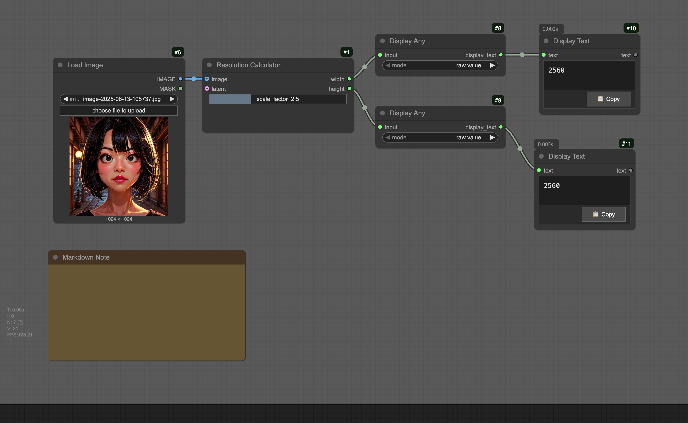

#### 📏 Width Height Selector
Advanced preset-based dimension selection with visual swap button.

- **26 Curated Presets**: SDXL, FLUX, and Ultra-Wide optimized resolutions
- **Smart Categories**: Organized by model type and aspect ratio
- **Visual Swap Button**: Modern blue button for quick orientation changes
- **Intelligent Swapping**: Preset-aware orientation switching
- **Custom Support**: Manual dimension input with validation

**Use Cases:**
- Quick dimension selection for different models
- Consistent aspect ratios across workflows
- Mobile and ultra-wide format support
- Integration with upscaling pipelines

#### 🎲 Seed History
Advanced seed tracking with interactive history management and UI.

- **Automatic Tracking**: Monitors all seed changes with timestamps
- **Interactive History**: Click any historical seed to reload instantly
- **Smart Deduplication**: 500ms window prevents duplicate rapid additions
- **Persistent Storage**: History survives browser sessions and ComfyUI restarts
- **Auto-Hide UI**: Clean interface that hides after 2.5 seconds of inactivity
- **Visual Feedback**: Toast notifications and selection highlighting

**Use Cases:**
- Track promising seeds during creative exploration
- Quickly return to successful generation parameters
- Maintain reproducibility across sessions
- Compare results from different seeds efficiently

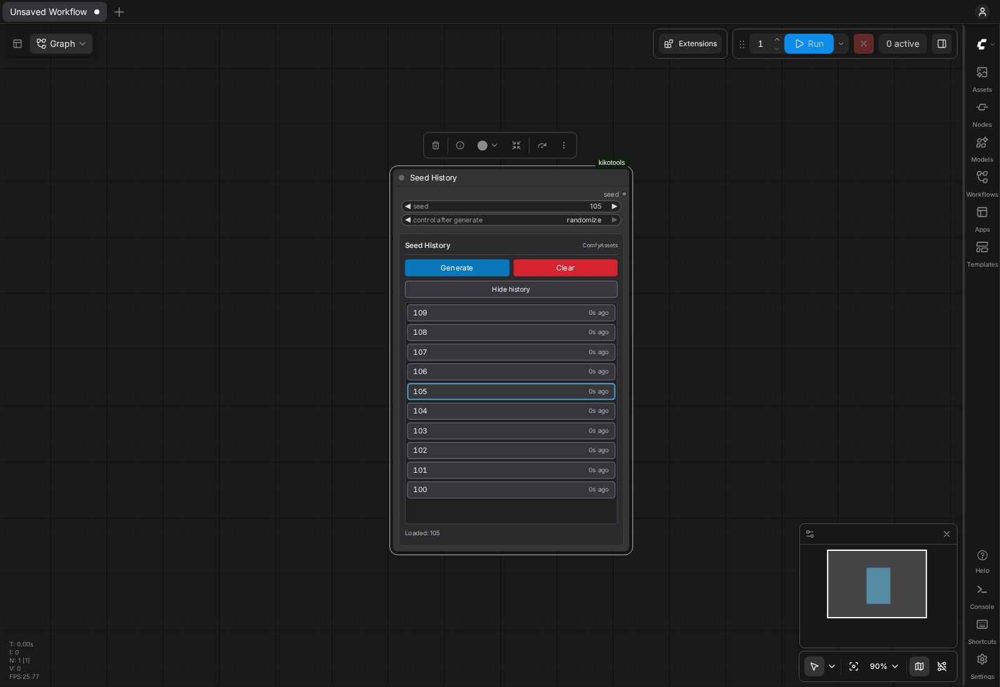

#### 🧭 Model Recommended Settings
Outputs the steps, CFG, sampler and scheduler a model's author recommends, ready to wire into KSampler.

- Reads the Civitai info LoRA Manager (or Civitai Helper) already stored for the model: a `.metadata.json` / `.civitai.info` next to the file, or LoRA Manager's central sidecar folder. Nothing is downloaded
- Settings the description calls recommended win, read from that passage on (an older version's settings earlier in the text are ignored); otherwise the most common values on the example images, then anything else the description states ("8 steps · CFG 1 · ER SDE · Beta")
- Civitai sampler names are translated ("DPM++ 2M Karras" → `dpmpp_2m` + `karras`), and ComfyUI names (`er_sde`, `sgm_uniform`) are read as written
- The widgets are the fallback, and each `use_model_*` switch keeps that field on its widget (all off = the same settings for every model)
- A sampler or scheduler that is not installed (e.g. `er_sde/bong_tangent` in a description) falls back to the widget, or to your substitute
- `info` says where every value came from
- Wire `model_name` from Checkpoint Folder Iterator's `ckpt_name`, and every model in a sweep runs with its own settings

Overrides go in `ComfyUI/user/kikotools/model_settings.json` (names or globs match the file name without extension):

```json
{
  "models": {"my-fast-merge*": {"steps": 8, "scheduler": "bong_tangent"}},
  "schedulers": {"bong_tangent": "beta"},
  "samplers": {"res_2s": "er_sde"}
}
```


Example workflow (a diffusion-model sweep with Checkpoint Folder Iterator and Model Compare Sheet): [model_recommended_settings_example.json](examples/workflows/model_recommended_settings_example.json)

#### ⚙️ Sampler Combo
Unified sampling configuration interface combining sampler, scheduler, steps, and CFG.

- **All-in-One Interface**: Single node for complete sampling configuration
- **Smart Recommendations**: Optimal settings suggestions per sampler type
- **Compatibility Validation**: Ensures sampler/scheduler combinations work well
- **Intelligent Defaults**: Context-aware parameter recommendations
- **Range Validation**: Prevents invalid parameter combinations
- **Comprehensive Tooltips**: Detailed guidance for each parameter

**Use Cases:**
- Simplify complex sampling workflows
- Ensure optimal sampler/scheduler combinations
- Reduce node clutter in workflows
- Quick sampling parameter experimentation

#### 📦 Empty Latent Batch
Advanced empty latent creation with preset support and batch processing capabilities.

- **Preset Integration**: 26 curated resolution presets with model optimization
- **Batch Processing**: Create multiple empty latents (1-64) in a single operation
- **Visual Swap Button**: Interactive blue button for quick dimension swapping
- **Smart Validation**: Automatic dimension sanitization for VAE compatibility
- **Memory Estimation**: Built-in memory usage calculation and warnings
- **Model-Aware Presets**: SDXL (~1MP), FLUX (high-res), and Ultra-wide options

**Use Cases:**
- Initialize batch processing workflows efficiently
- Create consistent latent dimensions across model types
- Optimize memory usage with batch size planning
- Quick preset-based latent generation for different aspect ratios

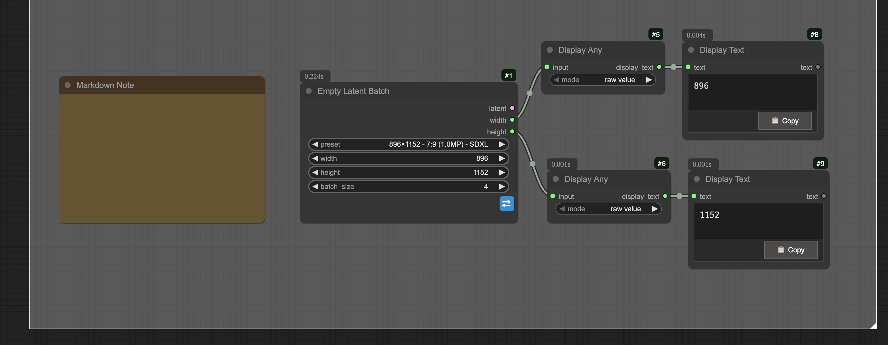

#### 🎯 Model Resolution Picker
Choose a model family and a size from ratio chips, and get an empty latent plus width and height.

- **Model Dropdown**: 16 shipped families (SD 1.5, SDXL, Illustrious XL, Flux.1, Flux.2, Qwen-Image, MiniMax H3 Image and more) with their preferred sizes
- **Chips and List**: Pick an aspect ratio chip, then a size from the list under it; the header shows `W × H · ratio · MP`
- **Resolution Dropdown**: A native `resolution` dropdown (`custom` plus size labels like `1216×832 - 3:2 (1.0MP)`) lists the active chip's sizes and stays in sync with the chips; a listed size wins over width and height when the node runs
- **Swap W×H**: Exchanges width and height and lands on the mirrored chip
- **Custom Ratio and Resolution**: Enter a ratio like 16:9 or type width and height; sizes are rounded to the family's step
- **Your Own Sizes**: An optional override file at `ComfyUI/user/kikotools/model_resolutions.json` (under the default user directory) can replace a family by label, add new ones, hide shipped ones with `remove`, or set `default`; an invalid file is ignored and the panel shows why ([details](examples/documentation/model_resolution_picker.md#user-override-file))
- **Outputs**: `latent` (4-channel 8x, resizable for 16x and 32x VAEs), `width` and `height`
- **Keyframe Rows**: Video families (Wan 2.2, LTX-2, HunyuanVideo 1.5, MiniMax H3) are first/last-frame sizes; the latent is an image latent, never fed to a video model

**Use Cases:**
- Pick the right size for each model without remembering bucket lists
- Switch families while keeping a listed size
- Feed one node to both the latent and the size inputs of a workflow

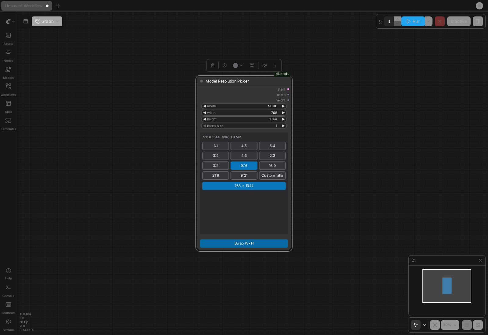

Example workflow: [model_resolution_picker_example.json](examples/workflows/model_resolution_picker_example.json)

#### 💾 Kiko Save Image
Enhanced image saving with format selection, quality control, and floating popup viewer.

- **Multiple Format Support**: Save as PNG, JPEG, or WebP with format-specific optimizations
- **Advanced Quality Controls**: JPEG/WebP quality (1-100), PNG compression (0-9), WebP lossless mode
- **Floating Popup Viewer**: Draggable, resizable window that shows saved images immediately
- **Interactive Previews**: Click any image to open in new tab, download individual images
- **Batch Selection**: Multi-select images for bulk actions (open all, download all)
- **Format-Specific Settings**: Quality indicators, file size display, compression info
- **Smart UI**: Auto-hide/show, minimize/maximize, roll-up functionality
- **Popup Toggle**: Enable/disable popup viewer per save operation

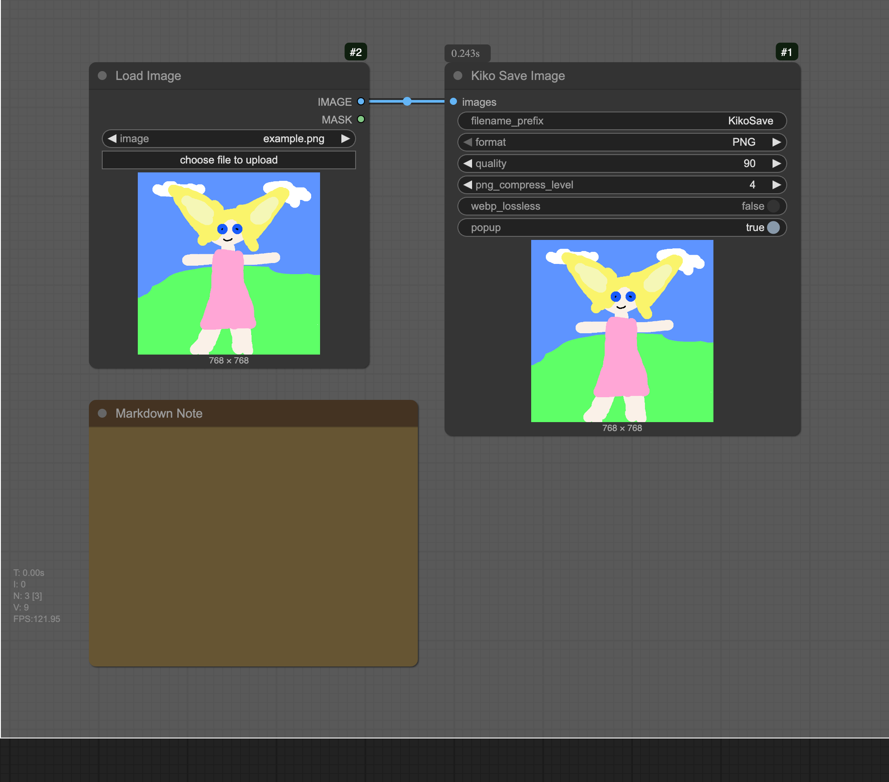

#### 📋 Display Text
Advanced text display node with intelligent formatting and enhanced user interaction.

- **Smart Prompt Detection**: Automatically detects positive/negative prompt pairs and displays in split view
- **Text Wrapping**: Proper word wrapping that reflows when node is resized
- **Scrollable Content**: Mouse wheel scrolling for long texts with visual scroll indicators
- **Copy Functionality**: Always-visible copy button with visual feedback
- **Split View Mode**: Automatic detection and formatting of SDXL-style prompts
- **Responsive Design**: Content adapts to node resizing with proper text reflow
- **Clean Formatting**: Strips prompt labels when copying for direct use

**Use Cases:**
- Display generated prompts with proper formatting
- Compare positive and negative prompts side-by-side
- Copy prompts without manual label removal
- View long text content with proper wrapping
- Debug prompt generation workflows

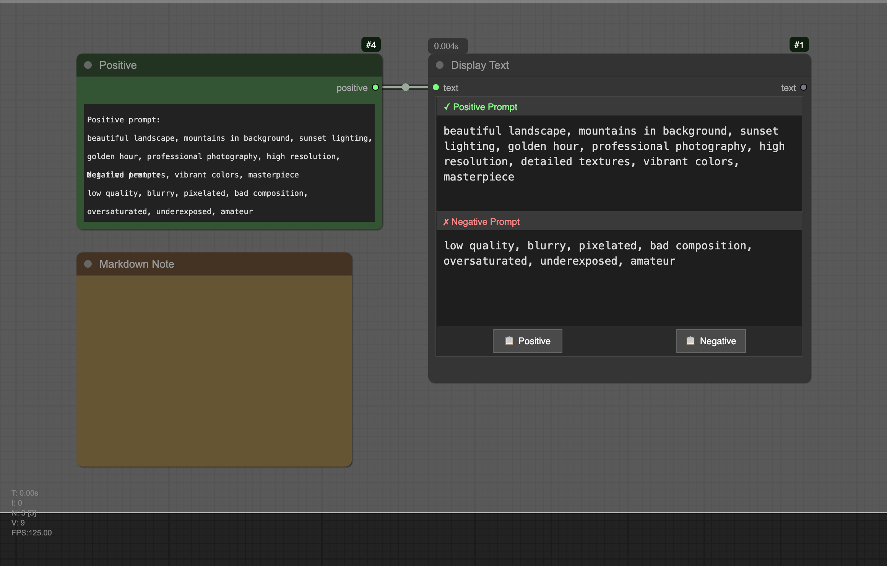

#### 🤖 Gemini Prompt Engineer

**Deprecated — retained for existing workflows only.** ComfyUI hides this node
from normal new-node discovery using its deprecated-node metadata. The
`GeminiPrompt` identifier, inputs, outputs and execution remain available so
saved workflows can still load.

Google API/model compatibility updates and UI migration have ended. Existing
workflows still depend on Google's service and the optional `google-genai`
package; deprecation does not guarantee future API compatibility. See the
[legacy Gemini documentation](examples/documentation/gemini_prompt.md) for the
existing configuration and behavior.

#### 🔍 Display Any
Universal debugging node that displays any type of input value or tensor information.

- **Universal Input Acceptance**: Works with any data type (tensors, strings, numbers, lists, dicts)
- **Two Display Modes**: Raw value showing string representation, or tensor shape extraction
- **Nested Structure Support**: Finds tensors within complex nested data structures
- **Debugging Focus**: Essential tool for understanding data flow and tensor dimensions
- **Clean Output**: Formatted display directly in ComfyUI interface

**Use Cases:**
- Debug tensor dimensions at any point in workflow
- Inspect latent space data structures
- View metadata and configuration objects
- Track shape changes through processing nodes
- Understand complex data types in ComfyUI

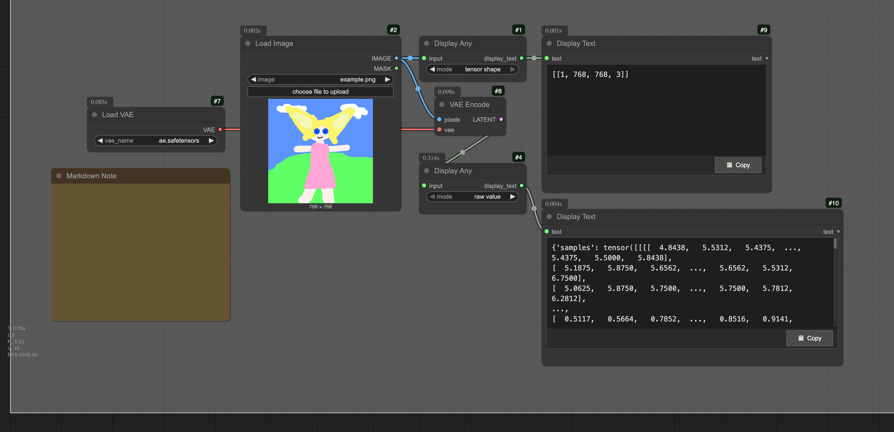

#### 🖼️ Image to Multiple Of
Adjusts image dimensions to be multiples of a specified value for model compatibility.

- **Dimension Adjustment**: Ensures image dimensions are multiples of specified value (e.g., 64, 128)
- **Two Processing Methods**: Center crop for minimal loss, or rescale to fit
- **Model Compatibility**: Essential for models requiring specific dimension constraints
- **Flexible Multiple Values**: Support from 1 to 256 with 16-step increments
- **Preserves Quality**: Smart processing maintains image quality

**Use Cases:**
- Prepare images for VAE encoding (multiple of 8 requirement)
- Ensure compatibility with specific model architectures
- Standardize dimensions across image batches
- Fix dimension errors in complex workflows
- Optimize for tiled processing requirements

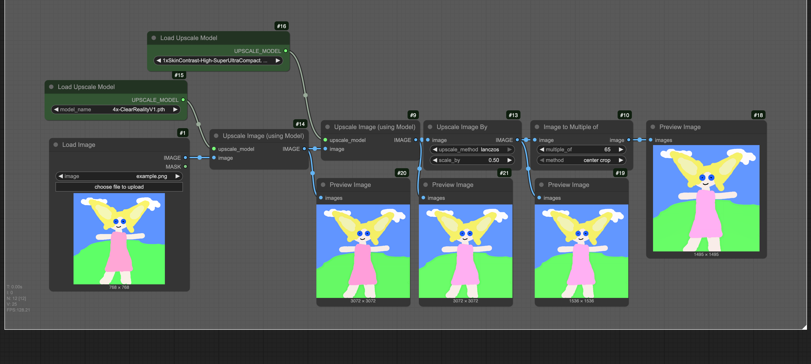

#### 📉 Image Scale Down By
Efficiently scale images down by a specified factor with quality preservation.

- **Proportional Scaling**: Reduces both width and height by the same factor
- **Quality Preservation**: Uses bilinear interpolation with antialiasing
- **Batch Support**: Process multiple images simultaneously
- **Memory Efficient**: Optimized for large image batches
- **Flexible Factor**: Scale from 0.01x to 1.0x with 0.01 precision

**Use Cases:**
- Create thumbnails or preview images
- Reduce memory usage for large workflows
- Generate image pyramids for multi-scale processing
- Quick downsampling for performance optimization
- Prepare images for web display or transmission

#### 🎬 Film Grain
Add realistic analog film grain effects to generated images.

- **Realistic Grain Simulation**: Mimics actual film photography characteristics
- **Grain Size Control**: Fine to coarse grain patterns (0.25x to 2.0x)
- **Intensity Adjustment**: Variable strength from subtle to pronounced (0-10)
- **Color Saturation**: Monochrome to full color grain (0-2)
- **Shadow Lifting (Toe)**: Film-like shadow response curves
- **Red Multiplier**: Adjust red channel independently for vintage looks
- **Alpha Preservation**: Maintains transparency when present
- **ITU-R BT.709 Color Space**: Professional color handling

**Use Cases:**
- Add vintage film aesthetic to AI-generated images
- Create cinematic looks with authentic grain patterns
- Simulate different film stocks (35mm, 16mm, etc.)
- Add texture to overly smooth AI renders
- Match grain from reference photography

#### 🎛️ Flux Sampler Params
FLUX-optimized parameter generator with intelligent batch processing capabilities.

- **FLUX-Specific Tuning**: Optimized guidance, shift values, and step counts for FLUX models
- **Batch Parameter Testing**: Generate multiple parameter sets for comparative analysis
- **LoRA Integration**: Seamlessly combine with LoRA Folder Batch for comprehensive testing
- **Smart Defaults**: Pre-configured optimal settings based on extensive FLUX testing
- **Range Syntax Support**: Use `start...end+step` notation for parameter sweeps

**Use Cases:**
- Test different guidance and shift value combinations
- Batch process with varying parameters
- Optimize FLUX generation quality
- Integrate with LoRA testing workflows

#### 📁 LoRA Folder Batch
Automated batch processing for multiple LoRA models from folders.

- **Automatic Scanning**: Discovers all .safetensors files in specified folders
- **Natural Epoch Sorting**: Intelligently sorts training epochs (epoch_004, epoch_020, etc.)
- **Pattern Filtering**: Include/exclude LoRAs using powerful regex patterns
- **Flexible Strength Control**: Single, multiple, or range-based strength values
- **Batch Modes**: Sequential or combinatorial strength application
- **Epoch Detection**: Automatically extracts epoch numbers from filenames

**Use Cases:**
- Test all epochs from a training run
- Compare different LoRA versions
- Evaluate strength variations
- Batch process style transfers

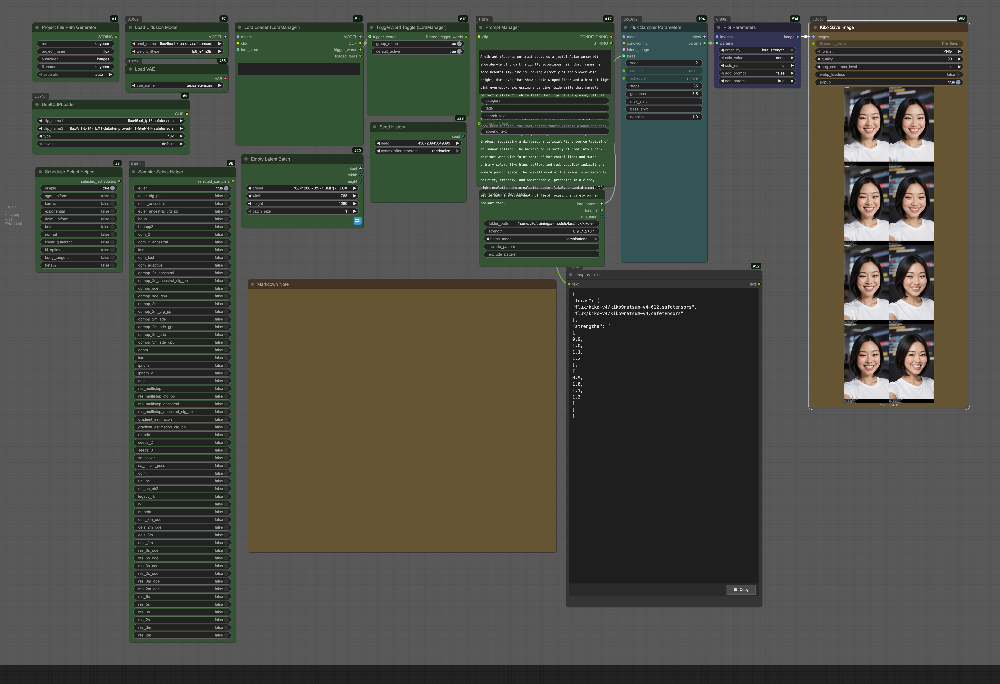

#### 🔁 Checkpoint Folder Iterator
Run the same prompt through every checkpoint in a folder, one model per queued run.

- **folder**: relative to `models/checkpoints`, or an absolute path anywhere on disk; regex include/exclude filters
- **index** with `control_after_generate`: set 0 + *increment*, then queue a batch count equal to the checkpoint count
- Queuing past the last checkpoint fails that run with a clear message instead of wrapping around, so the finished sweep is never restarted or archived by accident
- Outputs MODEL/CLIP/VAE for the indexed file plus `ckpt_name`, `label`, `index`, `count`
- **model_type** `diffusion_model` scans `models/diffusion_models` instead and loads the file like Load Diffusion Model (MOSS, Flux and other split models); only MODEL is set, so wire CLIP and VAE from their own loaders
- Only one checkpoint is loaded at a time, so large folders do not exhaust RAM

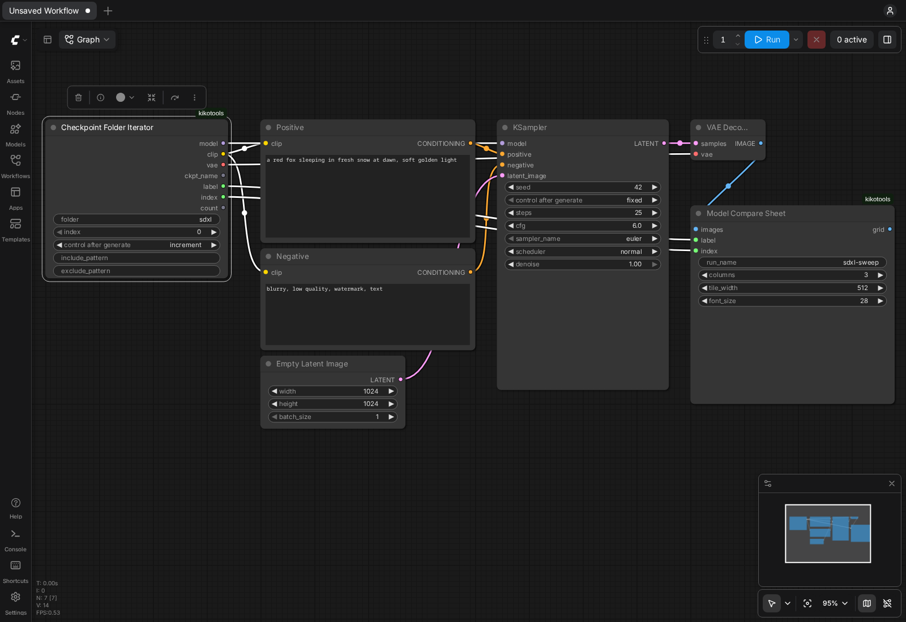

Example workflows: [checkpoint_folder_iterator_example.json](examples/workflows/checkpoint_folder_iterator_example.json) · [diffusion models, with per-model settings](examples/workflows/model_recommended_settings_example.json)

#### 🧩 Model Compare Sheet
Output node that pairs with Checkpoint Folder Iterator.

- Saves each run's image(s) to `output/model_compare/<run_name>/<NN>_<label>.png`
- Rebuilds `grid.png` from every tile saved so far, each labeled with its filename
- `columns`, `tile_width`, `font_size` control the layout; the grid is also returned as IMAGE
- The node preview (and anything else that reads it) gets `grid_preview.png`, at most 1024 px wide; `grid.png` keeps full resolution
- After the last queued run the preview shows the complete sheet
- Wire Project File Path into `run_name` for `project/date/sweep` folders
- A run at index 0 moves tiles already in the folder to `<run_name>_<timestamp>`, so an interrupted sweep never leaks into the new grid
- A run whose settings differ from the ones the grid was started with (prompt, sampler settings, size, LoRAs: everything except the iterator's index and seeds) also starts a new grid the same way, so one sheet never mixes prompts even when the index was not reset
- Rerunning a nonzero index replaces its complete batch, even when the label or batch size changes; other indexes are preserved
- Replacement PNGs are fully written before existing tiles are changed; a failed tile write preserves the prior tiles and grid

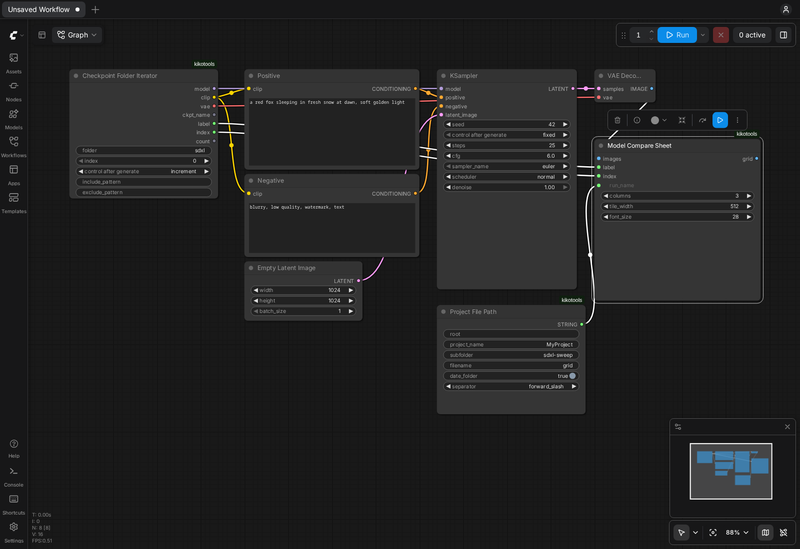

Example workflow (with Project File Path in `run_name`): [model_compare_sheet_example.json](examples/workflows/model_compare_sheet_example.json)

#### 📊 Plot Parameters
Visual analysis tool for understanding parameter relationships and effects.

- **Multiple Plot Types**: Line, bar, scatter, and heatmap visualizations
- **Parameter Correlation**: Analyze relationships between settings and quality
- **Statistical Analysis**: Calculate means, deviations, and trends
- **Export Capabilities**: Save plots as images or CSV data
- **Real-time Updates**: Dynamic graph generation during workflow execution

**Use Cases:**
- Visualize parameter impact on quality
- Compare batch generation results
- Analyze optimal parameter ranges
- Document generation experiments

#### 🎯 Sampler Select Helper
Intelligent sampler selection with model-aware recommendations.

- **Model Detection**: Automatic identification of SDXL, SD1.5, or FLUX models
- **Quality Presets**: Fast, balanced, quality, and extreme presets
- **Compatibility Checking**: Ensures optimal sampler-scheduler pairs
- **Performance Profiles**: Pre-configured settings for different use cases
- **Dynamic Discovery**: Adapts to newly available samplers

**Use Cases:**
- Automatic optimal sampler selection
- Quick quality vs speed adjustments
- Model-specific optimization
- A/B testing different samplers

#### 📅 Scheduler Select Helper
Optimal scheduler selection based on sampler and model requirements.

- **Sampler-Aware**: Recommends best schedulers for each sampler
- **Noise Schedule Visualization**: Preview and compare schedule curves
- **Model Optimization**: Specific tuning for SDXL, SD1.5, and FLUX
- **Schedule Types**: Smooth, sharp, linear, and custom curves
- **Beta Schedule Support**: Advanced control with custom beta values

**Use Cases:**
- Find optimal scheduler for your sampler
- Visualize noise reduction curves
- Compare different schedule types
- Fine-tune generation behavior

#### ✍️ Text Encode Sampler Params
Unified interface for text encoding and sampler parameter management.

- **All-in-One Node**: Combine prompt encoding with sampling configuration
- **Template System**: Pre-configured settings for portraits, landscapes, etc.
- **Prompt Syntax Support**: Wildcards, emphasis, and alternation
- **Batch Processing**: Handle multiple prompts efficiently
- **Model-Aware Encoding**: Optimize for different text encoders

**Use Cases:**
- Streamline text-to-image workflows
- Apply consistent settings across prompts
- Quick template-based generation
- Batch prompt processing

#### 📂 Local Image Loader
A gallery in the node for picking an image from a local folder and loading it into the workflow.

- **Gallery.** Thumbnails fill the node's width. The breadcrumb path and the up button move between folders, and page controls split large folders.
- **File types.** The node loads JPG, PNG, BMP, GIF and WebP images. The gallery also lists videos (MP4, WebM, MOV, MKV, AVI) and audio (MP3, WAV, OGG, FLAC), but the node does not output them.
- **Sorting.** Sort by name, date or file size, ascending or descending.
- **Saved paths.** Save a folder to the *Saved paths* list to open it again later.
- **Full-size view.** Double-click a file to open it in a new browser tab.
- **`info` output.** JSON with the image's file name, width, height, color mode and format. It also holds the prompt and workflow when ComfyUI saved them in the PNG, and the A1111 `parameters` text when there is one.
- **`folder` output.** The path of the folder the gallery shows, so you can pick a folder by browsing to it.
- **Refs for MiniMax H3.** Ctrl-click (Cmd-click on a Mac) images to pick them in order. Each picked image shows its number, and the `Refs: N` bar has a *Clear refs* button. A plain click still selects the single `image` output.
- **`refs` output.** The picked images, in pick order, for the `refs_bundle` input of Create H3 RefMod in ComfyUI-MiniMaxH3Mod. It takes images only, up to 256. The workflow saves the picks.
- **Ref size.** The first pick sets the size. The node scales each other pick to cover that size and crops the center, the same rule Create H3 RefMod uses.
- **`refs_preview` output.** The same images as one IMAGE batch, so you can see what Create H3 RefMod will encode. It shares memory with `refs`, so connecting it costs no extra memory.

**Use cases:**
- Load a reference image from a local folder for img2img.
- Pick one image from a folder of generated images.
- Read the prompt and settings of an image you generated earlier.
- Browse to a training dataset and pass its folder to a captioning or training node.
- Pick 5 to 8 photos of a character and build an H3 RefMod from them.

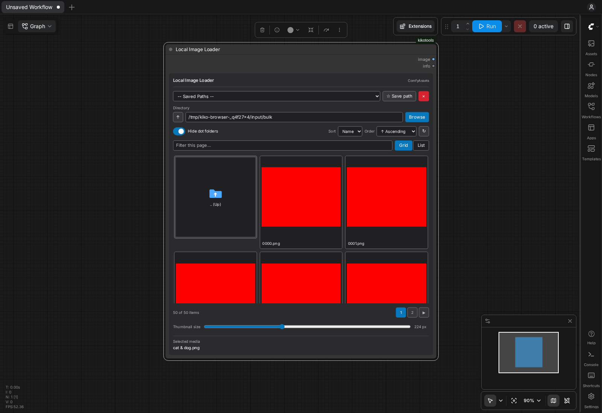

Example workflow: [local_image_loader_example.json](examples/workflows/local_image_loader_example.json) · [Nodes 2.0 screenshot](docs/screenshots/live-image-loader/nodes2.png)

#### 🌐 Model Downloader
Download models, LoRAs, and other assets directly from CivitAI, HuggingFace, and custom URLs within ComfyUI.

- **Multi-Platform Support**: CivitAI, HuggingFace, and direct download URLs
- **Smart URL Detection**: Automatic detection of download source and file handling
- **API Tokens on the Server**: Civitai and Hugging Face tokens come from the ComfyUI server's environment, so workflows never carry them
- **Progress Reporting**: Real-time download progress with speed indicators
- **Resume Support**: Skip existing files or force re-download
- **Interrupt Handling**: Respects ComfyUI's "Cancel current run" button
- **Automatic Cleanup**: Removes partial downloads on cancellation
- **Custom Filenames**: Override auto-detected filenames when needed
- **SHA256 Check**: Optional expected hash; a download that does not match is discarded, and an existing file is checked instead of trusted

**Platform Features:**
- **CivitAI**: Model page URLs, version-specific downloads, API authentication; civitai.com, civitai.green and civitai.red links
- **HuggingFace**: Blob and resolve URLs, branch/revision support, gated model access
- **Custom URLs**: Direct download links; only a token typed on the node is sent

**Use Cases:**
- Download models without leaving ComfyUI
- Automate asset acquisition in workflows
- Access private or gated models with API tokens
- Build reproducible workflows with automatic model fetching
- Quickly test new models from the community

**Tokens:** many Civitai models and gated Hugging Face models need a token. Leave the node's `api_token` empty and set the tokens where ComfyUI starts; a token typed on the node is saved inside the workflow. Each token goes only to its own site.

| Site | Variable | Get a token |
|------|----------|-------------|
| Civitai | `CIVITAI_API_KEY` | civitai.com → Account settings → API Keys |
| Hugging Face | `HF_TOKEN` (or run `hf auth login` once) | huggingface.co → Settings → Access Tokens (read) |

Linux / macOS, in `~/.bashrc` or `~/.zshrc` (or the script that starts ComfyUI):
```bash
export CIVITAI_API_KEY="your-civitai-key"
export HF_TOKEN="hf_your-token"
```

Windows, once in a Command Prompt (then open a new window and start ComfyUI):
```bat
setx CIVITAI_API_KEY "your-civitai-key"
setx HF_TOKEN "hf_your-token"
```
For the portable build you can instead add `set CIVITAI_API_KEY=your-civitai-key` and `set HF_TOKEN=hf_your-token` above the `python` line in `run_nvidia_gpu.bat`.

Restart ComfyUI after setting them.

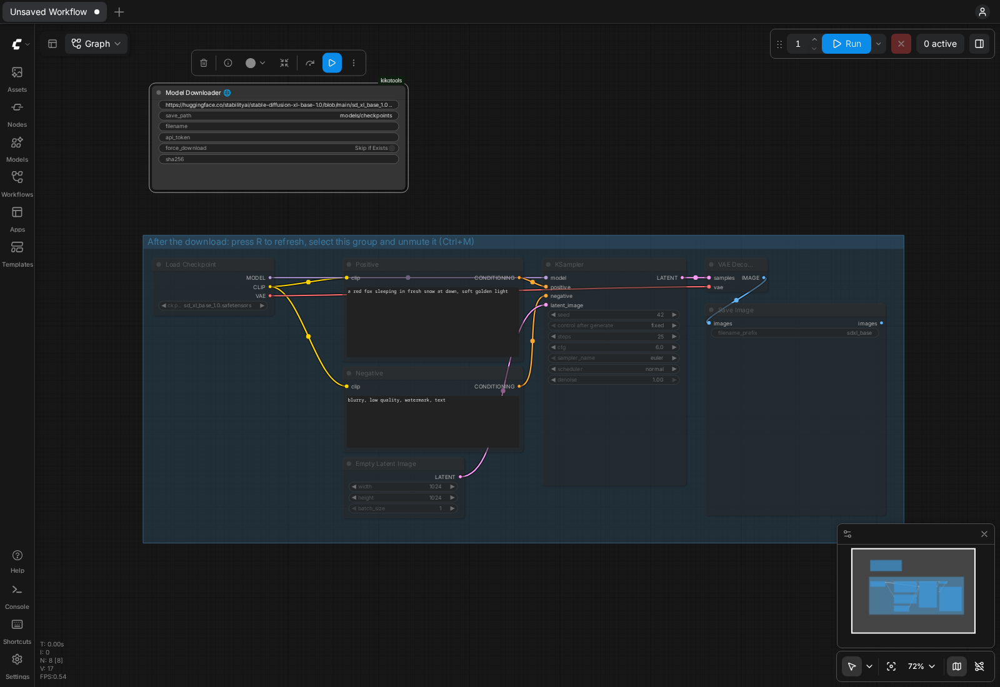

Example workflow: [model_downloader_example.json](examples/workflows/model_downloader_example.json). Queue it once to download, then refresh and unmute the generation group.

#### 🧠 Kiko Prompt Enhancer
Rewrites a short prompt in the style the chosen base model likes, using a local text encoder or GGUF model, or the encoder you already loaded (the `CLIP` input). No network access.

- **Inputs**: `prompt`, `base_model`, `model`, `mode`, `seed`
- **base_model**: one system prompt per model: `anima`, `flux2-klein`, `illustrious`, `krea2`, `moss`, `qwen-image`, `sdxl-realism`, `wan-i2v`, `wan-t2v`, `z-image`
- **model**: the LLM that does the rewriting. `native: <file>` entries are safetensors text encoders from `models/text_encoders` that ComfyUI can generate text with (Qwen3 4B/8B, Qwen3-VL 4B/8B, Qwen2.5 7B, Qwen3.5); `gguf: <file>` entries are GGUF files from `models/LLM` or `models/text_encoders`. The default is the first `native:` entry whose name contains `uncensored`, `abliterated` or `heretic`, then the first such entry of any kind, otherwise the first entry. If nothing is found the list shows `(none found)`
- **mode**: `text` (default) rewrites the prompt; `vision` describes or animates the connected image. Vision mode without an image stops with "vision mode needs an image", and a model that cannot read images stops with "cannot read images; pick a vision model". Native Qwen3.5, Qwen3-VL and Qwen2.5 7B encoders can read images; a GGUF can when an `mmproj` file sits in the same folder
- **clip** (optional): a connected `CLIP` overrides `model`, so a workflow saved with a model this machine doesn't have still runs. Without a clip, a missing model stops with "No model named '<model>' and no clip connected; pick a model or connect an encoder"
- **trigger_words** (optional): comma-separated; placed first in the result and also removed from the prompt text before the LLM sees it. Describe the subject in plain words in the prompt ("a woman", not the trigger)
- **image** (optional): used only in `vision` mode
- **Advanced**: `temperature`, `max_length`, `thinking`, `keep_loaded` (keeps a GGUF model in memory between runs; off by default, so it is freed after each run)
- **Outputs**: `prompt` and `system_prompt` (the system prompt that was used). There is no negative output, because most CFG 1 setups ignore negatives

**GGUF models** need `llama-cpp-python`, which KikoTools does not install; without it `gguf:` entries are not listed (a saved workflow that names one will not find its model). Only `.gguf` files whose names contain `qwen` or `llama` are listed; `mmproj` and JoyCaption files are never listed. Thinking is switched on or off through the model's own chat template (`enable_thinking`). Before a GGUF model loads, ComfyUI's loaded models are unloaded to free VRAM. It runs with all layers on the GPU, flash attention on CUDA and an 8192 token context.

**Customising:** put Markdown files in `ComfyUI/user/kikotools/system_prompts/`. A file with the same name as a shipped prompt replaces it; a new name adds a model to `base_model`. Updates never touch this folder. To start from a shipped prompt, right-click the node and choose "Copy system prompt to user folder", then edit the copy.

A prompt file may start with front matter and may include a `## With an image` section that is added to the system prompt when an image is used:

- `max_words`: the result is trimmed back to the last sentence end (or tag boundary) within the limit; trigger words don't count
- `no_text_sentence`: a sentence appended to the result only when it contains no quoted `"..."` or `“...”` span (so images that should show text are left alone). The cap is lowered by the sentence's word count

```markdown
---
max_words: 100
no_text_sentence: No text, no letters, no watermark.
---
You rewrite the user's idea into ...

## With an image
The image is the first frame ...
```

**Requirements:** for `native:` models and a connected `clip`, ComfyUI from September 2026 or newer (system-prompt support in the text encoder) and a chat-capable encoder such as Qwen3; older versions stop with an "Update ComfyUI" error. GGUF runs do not need this.

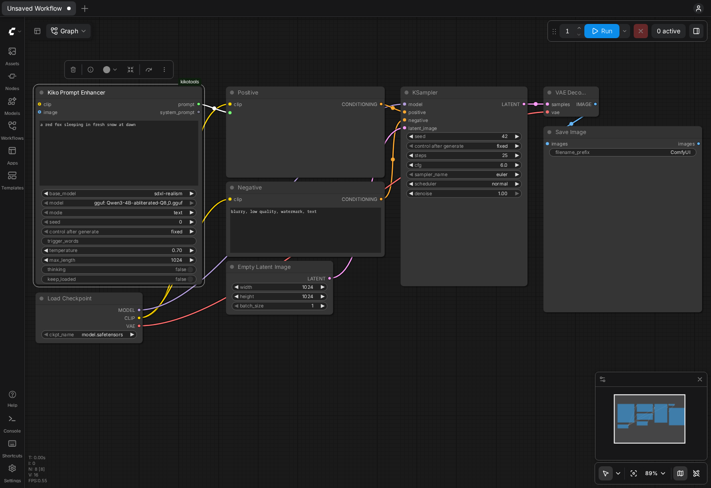

Example workflow: [prompt_enhancer_example.json](examples/workflows/prompt_enhancer_example.json)

#### 🫶 H3 Reference Prompter
Turns a short draft and up to three reference pictures (character, outfit, pose) into one long prompt for MiniMax H3 Image, using a local vision model. No network access. Full guide: [h3_reference_prompter.md](examples/documentation/h3_reference_prompter.md).

- **Inputs**: `prompt` (the draft), `model`, `role_1` to `role_3`, `seed`, and optional `image_1` to `image_3`
- **Picture tags**: `image_N` is always `<Picture N>`, and slots are never renumbered. The draft's sentences that carry a `<Picture N>` tag are written at the start of the prompt unchanged; the model writes everything after them. The prompt keeps exactly the tags the draft has: the node retries once, then stops with an error naming the missing or unexpected tags
- **Roles**: `character`, `outfit`, `pose` or `other`. Defaults: `image_1` character, `image_2` outfit, `image_3` pose
- **Two passes**: each picture is described once (cached for the ComfyUI session), then the prompt is written from the draft and those notes
- **model**: `hf: <folder>` (a transformers folder under `models/LLM` whose `config.json` lists a Qwen3.5, Qwen3-VL or Gemma 4 vision architecture), `native: <file>` (the Prompt Enhancer's vision text encoders) or `gguf: <file>` (a GGUF model with an `mmproj`). A GGUF model that fails to load stops with a message to use a transformers folder instead
- **Advanced**: `temperature` (0.7), `describe_tokens` (512), `write_tokens` (1536), `keep_loaded` (off)
- **Outputs**: `prompt` and `notes`, both lists. Notes are the per-picture descriptions
- **One per pose**: when `prompt` and `image_3` arrive as lists, each item gets its own prompt and notes, and its seed is the base seed plus the item index. Single values are used for every item
- **Memory**: before the model loads, ComfyUI's loaded models are freed with the same safe unload as Kiko Purge VRAM. Afterwards the prompt model is unloaded unless `keep_loaded` is on
- **Panel**: shows each prompt with its word count, previous and next buttons, a copy button and collapsible notes

Example workflow: [h3_reference_prompter_charsheet_test.json](examples/workflows/h3_reference_prompter_charsheet_test.json). It uses the [KikoCharSheet](https://github.com/ComfyAssets/ComfyUI-KikoCharSheet) pickers and shows the draft, the prompt and the notes in Display Text nodes. It does not draw an image.

#### ⏱️ Workflow Timer
Real-time execution timer that displays workflow duration with millisecond precision.

- **Live Timing**: Updates in real-time during workflow execution (MM:SS:mmm format)
- **Customizable Color**: Choose your preferred display color via KikoTools settings
- **Glow Effect**: Optional pulsing glow animation (can be enabled/disabled in settings)
- **Global Settings**: Color and glow preferences apply to all timer nodes
- **Persistent Display**: Shows final execution time after workflow completes
- **Multi-Node Sync**: All timer nodes stay synchronized during execution

**Use Cases:**
- Monitor workflow execution performance
- Compare generation times across different settings
- Identify slow nodes by adding timers at different workflow stages
- Track optimization improvements over time

**Settings (KikoTools Settings Panel):**
- **Workflow Timer: Color** - Custom color picker for timer display
- **Workflow Timer: Enable Glow** - Toggle pulsing glow effect on/off

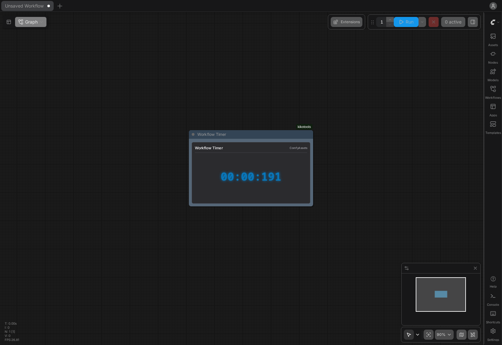

Example workflow: [workflow_timer_example.json](examples/workflows/workflow_timer_example.json) · [Color picker screenshot](docs/screenshots/workflow-timer/color-picker.png)

#### 🎨 Custom Colors

Right-click a node and choose **🫶 Custom Colors** to change its full color,
title or background. The shared picker supports hex entry, HSV sliders and
presets, and follows ComfyUI's dark/light theme. Changes apply immediately;
**Done** or **Escape** closes the picker. Multiple selected nodes receive the
same change. Right-click a group for its color option.

Existing Custom Colors settings control the available menu options and automatic
title shading. Node and group colors are saved with the workflow.

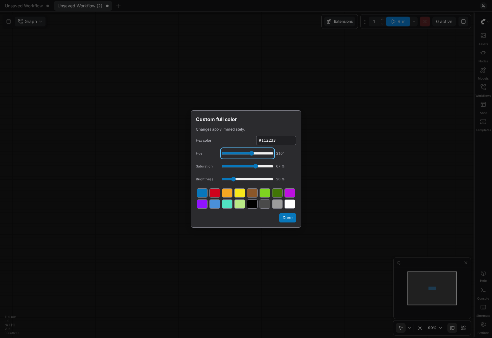

#### 🧭 Follow Execution

Enable **Follow Execution: Enable** in ComfyUI settings, then right-click the
canvas to follow/stop execution, show the executing node, or navigate to a node
by type. **Auto-start** begins following when a workflow starts. Disabling the
feature stops following immediately; enabling it again waits for a manual start
or the next workflow start when Auto-start is enabled. The same host menus work
in Classic and Nodes 2.0.

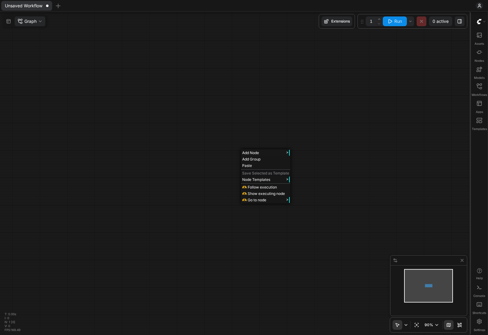

[Nodes 2.0 screenshot](docs/screenshots/follow-execution/nodes2.png)

#### 🗂️ Project File Path
Builds an organized save prefix to wire into a save node's `filename_prefix`.

- **Structure**: `root/project_name/[YYYY-MM-DD/]subfolder/filename`, e.g. `MyProject/2026-10-13/images/image`
- **Date Folder**: Optional toggle inserts today's date after the project; the node re-runs when the date changes
- **Safe Paths**: Unsafe characters are removed, spaces become underscores, and `..` segments are dropped so paths stay inside the output folder
- **Nested Folders**: Use `a/b` in `subfolder` for deeper structure
- **Extensions**: Known file extensions (`.png`, `.mp4`, ...) are stripped from `filename`; `render_v1.5` is left as is
- **Separator**: `auto`, `forward_slash` or `backslash`

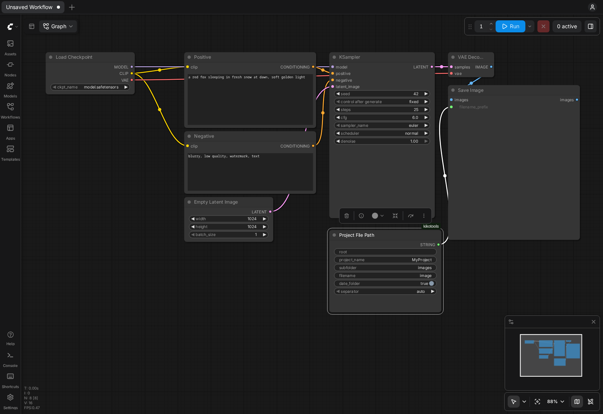

Example workflow: [project_file_path_example.json](examples/workflows/project_file_path_example.json)

Based on the idea of the Project File Path Generator from djz-nodes.

### 🔤 Embedding Autocomplete

**Intelligent autocomplete for embeddings, LoRAs, and custom tags in text prompts.**

<div align="center">
  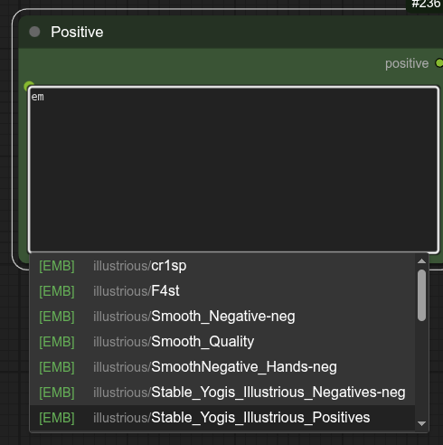
  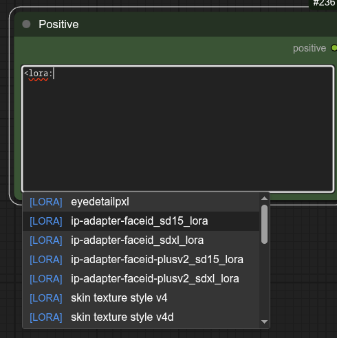
  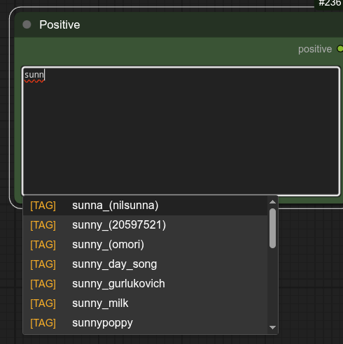
</div>

This feature is an enhanced fork of the autocomplete functionality from [ComfyUI-Custom-Scripts](https://github.com/pythongosssss/ComfyUI-Custom-Scripts) by pythongosssss. We've modernized the codebase, fixed existing bugs, and added robust security features.

**Key Features:**
- **Smart Triggers**: Type `embedding:` for embeddings, `<lora:` for LoRAs, or just start typing for tags
- **Custom Word Lists**: Import CSV/TXT files or browser-accessible URLs, including [versioned Danbooru tag packs](docs/tag-packs/README.md), with local offline caching
- **Safe Rendering**: Tag data stays plain text, with validated CSV fields and file-size limits
- **Flexible Settings**: Customize triggers, auto-insert commas, replace underscores, and more
- **Performance Optimized**: Handles 100,000+ tags smoothly with frequency-based sorting
- **Visual Polish**: Clean UI with proper scrolling, keyboard navigation, and type indicators

**Settings Include:**
- Enable/disable autocomplete for embeddings, LoRAs, and custom tags
- Configurable trigger phrases (e.g., `emb:`, `lora:`, custom shortcuts)
- Auto-insert comma after completion
- Replace underscores with spaces in tags
- Choose insertion keys (Tab, Enter, or both)
- Load custom word lists from URLs with security validation

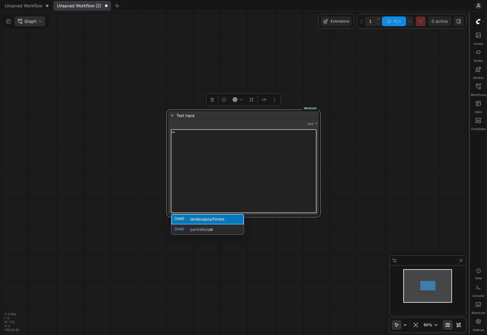

[Settings screenshot](docs/screenshots/embedding-autocomplete/settings-dark.png)

**Security Features:**
- Validates CSV structure, tag names, categories, counts, and file size
- Renders tag data as plain text rather than executable HTML or JavaScript
- Rejects control characters and HTML error documents
- File size limits to prevent memory exhaustion
- Clear error messages for rejected content

**Credits:**
- Original autocomplete concept by [pythongosssss](https://github.com/pythongosssss/ComfyUI-Custom-Scripts)
- Enhanced and modernized by KikoTools team

### 🧹 Kiko Purge VRAM
**Frees GPU memory between workflow stages, then passes the input through unchanged.**

Behaviour based on Free VRAM Pixaroma from [ComfyUI-Pixaroma](https://github.com/pixaroma/ComfyUI-Pixaroma) by Pixaroma.

**Key Features:**
- **Three Modes**:
  - `all` (default): unload models, collect garbage (when `collect_garbage` is on), then empty the GPU cache
  - `models`: unload models and collect garbage (when `collect_garbage` is on), leaving the cache alone
  - `cache`: empty the GPU cache, collecting garbage first when `collect_garbage` is on
- **Fixed Step Order**: models unload first, garbage is collected next (when `collect_garbage` is on), and the cache is emptied last
- **One-at-a-Time Unload**: the `models` step drains ComfyUI's loaded-model list one entry at a time, then calls `unload_all_models()` so other packs' hooks on it still run. Calling `unload_all_models()` alone can fail when one unload frees another model mid-loop and leave ComfyUI unable to start the next job. This is a deliberate difference from Free VRAM Pixaroma
- **Nothing Wired, Nothing Done**: with nothing connected to `anything`, the node does nothing and says so in the report
- **Free-Memory Threshold**: with `memory_threshold_mb` above 0, the purge is skipped when at least that many MB are already free. `0` always runs. The threshold never skips when memory can't be read
- **Every Run or Cached**: with `every_run` on (default), the node runs on each queue. Turn it off to let ComfyUI cache the node, so nodes after it do not re-run
- **Passthrough Design**: `passthrough` returns the input unchanged, so the node works as a checkpoint without disrupting data flow
- **Failures Stop the Run**: if a step fails, the node repairs ComfyUI's loaded-model list so later jobs keep working, logs the traceback, and stops the run with an error
- **Detailed Reporting**: `memory_report` shows the mode, memory freed, before and after figures, and timing

**Use Cases:**
- Free memory between heavy processing stages
- Prevent OOM errors in complex workflows
- Debug memory usage patterns
- Optimize multi-model workflows
- Clean up after batch processing

**Parameters:**
- **anything**: Any input (passed through unchanged). Leave it unconnected and the node does nothing
- **mode**: `all`, `models` or `cache`
- **report_memory**: Generate the memory report (on by default)
- **memory_threshold_mb**: Skip the purge when at least this many MB are already free (0 = always purge). Note: in saved workflows this value now means "skip when free", not "purge when used"
- **collect_garbage**: Run Python garbage collection after unloading models (on by default)
- **every_run**: Run on every queue (on by default). Off lets ComfyUI cache the node. With it off, a run where only a later stage changed reuses the cached node, so it does not purge and the earlier model stays loaded

**Legacy Mode Names:** Workflows saved with the old mode names still load and run. `soft` and `aggressive` map to `all`, `models_only` maps to `models`, and `cache_only` maps to `cache`. The report notes the old name.

**Example Output:**
```
Mode: all
Memory Freed: 8192.0 MB
Before: 2048.0 MB free of 24576.0 MB
After: 10240.0 MB free of 24576.0 MB
Time: 412.6ms
```

### 💾 Kiko Save Image Features

**Use Cases:**
- Quick preview and management of saved images without file browser navigation
- Compare multiple format outputs side-by-side (PNG vs JPEG vs WebP)
- Batch download or open selected images efficiently
- Monitor file sizes and compression effectiveness in real-time
- Streamlined workflow for iterative image generation and saving

**Why Better Than Standard Save Image:**
- **Immediate Visual Feedback**: See your saved images instantly without opening file explorer
- **Multi-Format Flexibility**: Choose optimal format for your use case (PNG for quality, JPEG for size, WebP for modern efficiency)
- **Advanced Compression Control**: Fine-tune file sizes with format-specific quality settings
- **Batch Operations**: Handle multiple images efficiently with selection and bulk actions
- **Modern UI**: Floating, draggable interface that doesn't interrupt your workflow
- **Smart Memory Usage**: File size indicators help optimize storage and sharing
- **One-Click Access**: Direct image opening in browser tabs for quick sharing or review

### 🔧 Architecture Highlights

- **Modular Design**: Each tool is self-contained and independently testable
- **Test-Driven Development**: Regression tests for Python logic, JavaScript extensions, and browser workflows
- **Clean Interfaces**: Standardized input/output patterns across all tools
- **Separation of Concerns**: Clear distinction between logic, UI, and integration layers
- **SOLID Principles**: Extensible architecture following software engineering best practices

## 📦 Installation

### ComfyUI Manager (Recommended)

1. Open ComfyUI Manager
2. Search for "ComfyUI-KikoTools"
3. Click Install
4. Restart ComfyUI

### Manual Installation

```bash
cd ComfyUI/custom_nodes/
git clone https://github.com/ComfyAssets/ComfyUI-KikoTools.git
cd ComfyUI-KikoTools
pip install -r requirements-dev.txt
```

Restart ComfyUI and look for **ComfyAssets** nodes in the node browser.

## 🎯 Quick Start

### Resolution Calculator Example

```
Image Loader → Resolution Calculator → Upscaler
             ↘ scale_factor: 1.5    ↗
```

**Input:** 832×1216 (SDXL portrait format)
**Scale:** 1.5x
**Output:** 1248×1824 (ready for upscaling)

### Width Height Selector Example

```
Width Height Selector → EmptyLatentImage → Model
preset: "1920×1080"   ↘ 1920×1080      ↗
[swap button]
```

**Preset:** FLUX HD (1920×1080)
**Output:** 1920×1080 (16:9 cinematic)
**Swap Button:** Click to get 1080×1920 (9:16 portrait)

### Seed History Example

```
Seed History → KSampler → VAE Decode → Save Image
🎲 12345    ↘ seed    ↗
[History UI: 54321, 99999, 11111...]
```

**Current Seed:** 12345
**History:** Auto-tracked previous seeds with timestamps
**Interaction:** Click any historical seed to reload instantly

### Sampler Combo Example

```
Sampler Combo → KSampler → VAE Decode → Save Image
⚙️ All Settings ↘ sampler/scheduler/steps/cfg ↗
```

**Configuration:** euler, normal, 20 steps, CFG 7.0
**Output:** Complete sampling configuration in one node
**Smart Features:** Recommendations and compatibility validation

### Empty Latent Batch Example

```
Empty Latent Batch → KSampler → VAE Decode → Kiko Save Image
📦 preset: "1024×1024" ↘ batch latents ↗                ↘ popup viewer ↗
   batch_size: 4
   [swap button]
```

**Preset:** SDXL Square (1024×1024)
**Batch Size:** 4 empty latents
**Output:** 4×4×128×128 latent tensor ready for sampling
**Swap Button:** Click to switch to any available swapped preset

### Kiko Save Image Example

```
Generate Image → Kiko Save Image → Floating Popup Viewer
📷 output       ↘ format: WEBP   ↘ draggable window ↗
                  quality: 85
                  [popup: enabled]
```

**Format:** WebP (efficient compression, modern format)
**Quality:** 85% (balanced size/quality)
**Popup Viewer:** Floating, draggable window with saved images
**Features:** Click images to open in new tabs, download individual files, batch selection
**Advantages:** Immediate preview without file explorer, multi-format comparison, advanced quality controls

### Display Text Example

```
Gemini Prompt → Display Text → Copy to Clipboard
📋 SDXL prompt ↘ auto-split  ↘ [📋 Positive] [📋 Negative]
                view          → formatted display
```

**Input:** Text with "Positive prompt:" and "Negative prompt:" sections
**Output:** Split view with individual copy buttons
**Features:** Text wrapping, scrolling, responsive resizing
**Smart Detection:** Automatically formats SDXL-style prompts

### Gemini Prompt Engineer Example

**Legacy example for the deprecated node; existing workflows only.**

```
Load Image → Gemini Prompt → Display Text → Text Generation Model
🖼️ reference ↘ type: SDXL   ↘ split view  ↘ "detailed portrait..."
               [Refresh Models]             → SDXL model
```

**Input:** Reference image for style analysis
**Prompt Type:** SDXL (positive/negative pairs with layered structure)
**Model Selection:** Dynamic list with latest Gemini models (2.0, 2.5)
**Output:** Optimized prompts following community best practices
**API:** Requires Gemini API key (free tier available)
**Refresh:** Click button to fetch latest available models

### Display Any Example
```
Any Node → Display Any → Debug Output
🔍 tensor  ↘ mode: shape ↘ "[[1, 3, 512, 512]]"
```

**Input:** Any data type (image, latent, config, etc.)
**Mode:** "raw value" or "tensor shape"
**Output:** Formatted display of value or tensor dimensions
**Use Case:** Debug workflows, inspect data structures

### Image to Multiple Of Example
```
Load Image → Image to Multiple Of → VAE Encode → KSampler
🖼️ 513×769  ↘ multiple: 64    ↘ 512×768     → latent
              method: crop
```

**Input:** Image with arbitrary dimensions
**Multiple Of:** 64 (common for VAE compatibility)
**Method:** "center crop" or "rescale"
**Output:** Adjusted image with compatible dimensions

### Prompt Enhancer Example

```
1. Add "🧠 Kiko Prompt Enhancer" (🫶 ComfyAssets/🧠 Prompts)
2. Type a short idea in prompt, e.g. "a red fox sleeping in fresh snow at dawn"
3. Set base_model to the model you render with (e.g. krea2) and pick an LLM in model
4. Put LoRA trigger words in trigger_words, not in the prompt
5. Connect the prompt output to your positive CLIP Text Encode
```

For an image + text prompt, connect an image, set `mode` to `vision` and pick a vision-capable model.

### Common Workflows

<details>
<summary><b>SDXL Portrait Upscaling</b></summary>

```json
{
  "workflow": "Load SDXL portrait → Calculate 1.5x dimensions → Feed to upscaler",
  "input_resolution": "832×1216",
  "scale_factor": 1.5,
  "output_resolution": "1248×1824",
  "memory_efficient": true
}
```
</details>

<details>
<summary><b>FLUX Batch Processing</b></summary>

```json
{
  "workflow": "Generate latents → Calculate target size → Batch upscale",
  "input_resolution": "1024×1024",
  "scale_factor": 2.0,
  "output_resolution": "2048×2048",
  "batch_optimized": true
}
```
</details>

<details>
<summary><b>LoRA Testing with xyz-helpers</b></summary>

```json
{
  "workflow": "Scan LoRA folder → Apply strength ranges → Generate grid → Plot parameters",
  "strength_range": "0.9...1.2+0.1",
  "batch_mode": "combinatorial",
  "features": ["automatic epoch sorting", "parameter visualization", "batch generation"]
}
```

Example workflow available: [xyz_helpers_lora_testing.json](examples/workflows/xyz_helpers_lora_testing.json)
</details>

## 📚 Documentation

### Available Tools

| Tool | Description | Status | Documentation |
|------|-------------|--------|---------------|
| **Resolution Calculator** | Calculate upscaled dimensions with model optimization | ✅ Complete | [Docs](examples/documentation/resolution_calculator.md) |
| **Width Height Selector** | Preset-based dimension selection with 26 curated options | ✅ Complete | [Docs](examples/documentation/width_height_selector.md) |
| **Seed History** | Advanced seed tracking with interactive history management | ✅ Complete | [Docs](examples/documentation/seed_history.md) |
| **Sampler Combo** | Unified sampling configuration with smart recommendations | ✅ Complete | [Docs](examples/documentation/sampler_combo.md) |
| **Empty Latent Batch** | Create empty latent batches with preset support | ✅ Complete | [Docs](examples/documentation/empty_latent_batch.md) |
| **Model Resolution Picker** | Model family size picker with ratio chips, empty latent and width/height outputs | ✅ Complete | [Docs](examples/documentation/model_resolution_picker.md) |
| **Kiko Save Image** | Enhanced image saving with popup viewer and multi-format support | ✅ Complete | [Docs](examples/documentation/kiko_save_image.md) |
| **Display Text** | Advanced text display with smart prompt detection and split view | ✅ Complete | [Docs](examples/documentation/display_text.md) |
| **Gemini Prompt Engineer** | Legacy image analysis and prompt generation | Deprecated | [Docs](examples/documentation/gemini_prompt.md) |
| **Display Any** | Universal debugging tool for any data type or tensor shapes | ✅ Complete | [Docs](examples/documentation/display_any.md) |
| **Image to Multiple Of** | Adjust image dimensions to multiples for model compatibility | ✅ Complete | [Docs](examples/documentation/image_to_multiple_of.md) |
| **Image Scale Down By** | Efficiently scale images down by a specified factor | ✅ Complete | [Docs](#-image-scale-down-by) |
| **Film Grain** | Add realistic analog film grain effects to images | ✅ Complete | [Docs](#-film-grain) |
| **Flux Sampler Params** | FLUX-optimized parameter generator with batch support | ✅ Complete | [Docs](examples/documentation/flux_sampler_params.md) |
| **LoRA Folder Batch** | Batch process multiple LoRAs from folders | ✅ Complete | [Docs](examples/documentation/lora_folder_batch.md) |
| **Plot Parameters** | Visualize parameter effects with graphs | ✅ Complete | [Docs](examples/documentation/plot_parameters.md) |
| **Sampler Select Helper** | Intelligent sampler selection with recommendations | ✅ Complete | [Docs](examples/documentation/sampler_select_helper.md) |
| **Scheduler Select Helper** | Optimal scheduler selection for samplers | ✅ Complete | [Docs](examples/documentation/scheduler_select_helper.md) |
| **Text Encode Sampler Params** | Combined text encoding and parameter management | ✅ Complete | [Docs](examples/documentation/text_encode_sampler_params.md) |
| **Local Image Loader** | Gallery that loads a local image, a folder path, or ordered refs for MiniMax H3 | ✅ Complete | [Docs](examples/documentation/local_image_loader.md) |
| **Model Downloader** | Download models from CivitAI, HuggingFace, and custom URLs | ✅ Complete | [Docs](#-model-downloader) |
| **Workflow Timer** | Real-time execution timer with customizable display | ✅ Complete | [Docs](#️-workflow-timer) |
| **Kiko Prompt Enhancer** | Rewrite a short prompt in a base model's preferred style with a local LLM | ✅ Complete | [Docs](#-kiko-prompt-enhancer) |
| **H3 Reference Prompter** | Write one long MiniMax H3 prompt from a draft and reference pictures | ✅ Complete | [Docs](examples/documentation/h3_reference_prompter.md) |
| **Model Recommended Settings** | Steps, CFG, sampler and scheduler from a model's Civitai info | ✅ Complete | [Docs](#-model-recommended-settings) |
| **Checkpoint Folder Iterator** | One checkpoint or diffusion model per queued run, from a folder | ✅ Complete | [Docs](#-checkpoint-folder-iterator) |
| **Model Compare Sheet** | Labeled grid of a model sweep, one tile per run | ✅ Complete | [Docs](#-model-compare-sheet) |
| **Batch Image Processor** | Process multiple images with consistent settings | 🚧 Planned | Coming Soon |
| **Advanced Prompt Utilities** | Enhanced prompt manipulation and generation | 🚧 Planned | Coming Soon |

### Technical Specifications

#### Resolution Calculator

**Inputs:**
- `scale_factor` (FLOAT): 1.0-8.0, default 2.0
- `image` (IMAGE, optional): Input image tensor
- `latent` (LATENT, optional): Input latent tensor

**Outputs:**
- `width` (INT): Calculated target width
- `height` (INT): Calculated target height

**Constraints:**
- All outputs divisible by 8 (ComfyUI requirement)
- Preserves aspect ratio
- Validates input tensors
- Graceful error handling

#### Width Height Selector

**Inputs:**
- `preset` (DROPDOWN): 26 preset options + custom
- `width` (INT): 64-8192, step 8, default 1024
- `height` (INT): 64-8192, step 8, default 1024

**Outputs:**
- `width` (INT): Selected or calculated width
- `height` (INT): Selected or calculated height

**UI Features:**
- Visual blue swap button in bottom-right corner
- Intelligent preset switching when swapping
- Modern hover effects and cursor feedback

**Preset Categories:**
- SDXL Presets (9): 1024×1024 to 1536×640 (~1MP optimized)
- FLUX Presets (8): 1920×1080 to 1152×1728 (high resolution)
- Ultra-Wide (8): 2560×1080 to 768×2304 (modern ratios)

#### Seed History

**Inputs:**
- `seed` (INT): 0 to 18,446,744,073,709,551,615, default 12345

**Outputs:**
- `seed` (INT): Validated and processed seed value

**UI Features:**
- Interactive history display with timestamps
- Generate random seed button (🎲 Generate)
- Clear history button (🗑️ Clear)
- Auto-hide after 2.5 seconds of inactivity
- Click-to-restore hidden history

**History Management:**
- Maximum 10 entries for optimal performance
- Smart deduplication with 500ms window
- Persistent localStorage storage
- Newest entries displayed first
- Human-readable time formatting (5m ago, 2h ago)

#### Sampler Combo

**Inputs:**
- `sampler_name` (DROPDOWN): Available ComfyUI samplers (euler, dpmpp_2m, etc.)
- `scheduler` (DROPDOWN): Available schedulers (normal, karras, exponential, etc.)
- `steps` (INT): 1-1000, default 20
- `cfg` (FLOAT): 0.0-30.0, default 7.0

**Outputs:**
- `sampler_name` (STRING): Selected sampler algorithm
- `scheduler` (STRING): Selected scheduler algorithm
- `steps` (INT): Validated step count
- `cfg` (FLOAT): Validated CFG scale

**Features:**
- Smart parameter validation and sanitization
- Sampler-specific recommendations for optimal settings
- Compatibility checking between samplers and schedulers
- Graceful error handling with safe defaults
- Comprehensive tooltips for user guidance

#### Empty Latent Batch

**Inputs:**
- `preset` (DROPDOWN): 26 preset options + custom with formatted metadata display
- `width` (INT): 64-8192, step 8, default 1024
- `height` (INT): 64-8192, step 8, default 1024
- `batch_size` (INT): 1-64, default 1

**Outputs:**
- `latent` (LATENT): Batch of empty latent tensors in ComfyUI format
- `width` (INT): Final sanitized width (divisible by 8)
- `height` (INT): Final sanitized height (divisible by 8)

**UI Features:**
- Visual blue swap button with hover and click feedback
- Intelligent preset switching when swapping dimensions
- Memory usage estimation and warnings for large batches
- Auto-update width/height widgets when presets change

**Batch Processing:**
- Creates tensors with shape: [batch_size, 4, height//8, width//8]
- Efficient memory allocation with torch.zeros
- Validates batch size limits (1-64) with performance warnings
- Compatible with all ComfyUI latent processing nodes

**Preset Integration:**
- Full access to 26 curated resolution presets from Width Height Selector
- Model-aware categorization (SDXL, FLUX, Ultra-wide)
- Formatted display with aspect ratio and megapixel information
- Intelligent fallback to custom dimensions for invalid presets

#### Kiko Save Image

**Inputs:**
- `images` (IMAGE): Batch of images to save
- `filename_prefix` (STRING): Prefix for saved filenames, default "KikoSave"
- `format` (DROPDOWN): Output format (PNG, JPEG, WEBP), default PNG
- `quality` (INT): JPEG/WebP quality (1-100), default 90
- `png_compress_level` (INT): PNG compression level (0-9), default 4
- `webp_lossless` (BOOLEAN): Use lossless WebP compression, default False
- `popup` (BOOLEAN): Enable popup viewer window, default True

**Outputs:**
- `UI`: Enhanced image preview data with popup viewer functionality

**UI Features:**
- Floating, draggable popup window showing saved images immediately
- Interactive image grid with click-to-open functionality
- Individual image download buttons with format-specific quality indicators
- Batch selection with multi-select checkboxes for bulk operations
- Window controls: minimize, maximize, roll-up, close, and dragging
- Auto-hide/show behavior with smart positioning

**Format Support:**
- **PNG**: Lossless compression with metadata preservation, configurable compression levels
- **JPEG**: Quality-controlled lossy compression with automatic transparency handling
- **WebP**: Modern format with both lossy and lossless modes, superior compression ratios

**Advanced Features:**
- File size monitoring and display for optimization feedback
- Format-specific quality indicators (PNG compression level, JPEG/WebP quality percentage)
- Smart filename sanitization with timestamp-based uniqueness
- Persistent popup viewer across multiple save operations
- Toggle button integration in node UI for manual viewer control

## 🛠️ Development

### Prerequisites

- Python 3.10+
- ComfyUI installation
- PyTorch 2.0+

### Development Setup

```bash
# Clone the repository
git clone https://github.com/ComfyAssets/ComfyUI-KikoTools.git
cd ComfyUI-KikoTools

# Create virtual environment
python -m venv venv
source venv/bin/activate  # On Windows: venv\Scripts\activate

# Install development dependencies
pip install -r requirements-dev.txt

# Install pre-commit hooks
pre-commit install

# Run tests
python -c "
import sys, os
sys.path.insert(0, os.getcwd())
from kikotools.tools.resolution_calculator.node import ResolutionCalculatorNode
import torch

# Quick test
node = ResolutionCalculatorNode()
result = node.calculate_resolution(2.0, image=torch.randn(1, 512, 512, 3))
print(f'✅ Development setup successful! Test result: {result[0]}x{result[1]}')
"
```

### Code Quality

We maintain high code quality standards with automated pre-commit hooks:

#### Pre-commit Hooks

Our pre-commit configuration automatically runs:
- **Black**: Code formatting (127 char line length)
- **Flake8**: Linting and style checks
- **Bandit**: Security vulnerability scanning
- **detect-secrets**: Prevents accidental secret commits
- File checks: trailing whitespace, YAML validation, merge conflicts

```bash
# Run all pre-commit hooks manually
pre-commit run --all-files

# Update hooks to latest versions
pre-commit autoupdate
```

#### Manual Code Quality Checks

```bash
# Format code
black .

# Lint code
flake8 .

# Type checking
mypy .

# Run all quality checks
make quality-check  # If Makefile exists
```

### Testing Philosophy

Following **Test-Driven Development (TDD)**:

1. **Write Tests First**: Define expected behavior before implementation
2. **Red-Green-Refactor**: Fail → Pass → Improve cycle
3. **Comprehensive Coverage**: Unit, integration, and scenario testing
4. **Real-World Validation**: Test with actual ComfyUI workflows

```bash
# Test structure
tests/
├── unit/                    # Individual component tests
├── js/                      # Extension and coverage-gate regression tests
└── browser/                 # Browser workflows and disposable host fixtures
```

### Adding New Tools

1. **Plan**: Define tool purpose, inputs, outputs in `plan.md`
2. **Test**: Write comprehensive tests following TDD
3. **Implement**: Build tool logic with proper validation
4. **Integrate**: Create ComfyUI node interface
5. **Document**: Add usage examples and workflows
6. **Validate**: Test in real ComfyUI environment

See our [Contributing Guide](CONTRIBUTING.md) for detailed instructions.

## 🤝 Contributing

We welcome contributions! Please see [CONTRIBUTING.md](CONTRIBUTING.md) for guidelines.

### Development Principles

- **KISS**: Keep It Simple, Stupid
- **Separation of Concerns**: Clear module boundaries
- **DRY**: Don't Repeat Yourself
- **SOLID**: Object-oriented design principles
- **TDD**: Test-driven development

### Reporting Issues

Please use GitHub Issues with:
- ComfyUI version
- Tool/node name
- Expected vs actual behavior
- Minimal reproduction steps
- Error logs if applicable

## 📄 License

MIT License - see [LICENSE](LICENSE) file for details.

## 🏷️ Tags

`comfyui` `custom-nodes` `image-processing` `ai-tools` `sdxl` `flux` `upscaling` `resolution` `batch-processing` `model-downloader` `civitai` `huggingface` `python` `pytorch`

## 🔗 Links

- **ComfyUI**: [https://github.com/comfyanonymous/ComfyUI](https://github.com/comfyanonymous/ComfyUI)
- **Documentation**: [examples/documentation/](examples/documentation/)
- **Example Workflows**: [examples/workflows/](examples/workflows/)
- **Issue Tracker**: [GitHub Issues](https://github.com/ComfyAssets/ComfyUI-KikoTools/issues)

## 📈 Stats

- **Registered Nodes**: 33, including the deprecated Gemini node
- **Extensions**: Embedding Autocomplete, Custom Colors and Follow Execution
- **Organization**: Tools grouped under ComfyAssets
- **Download Platforms**: 3 (CivitAI, HuggingFace, Custom URLs)
- **Format Support**: 3 (PNG, JPEG, WebP with advanced controls)
- **Presets**: 26 curated resolution presets
- **Interactive Features**: 8+ (swap buttons, history UI, popup viewers, parameter visualization)
- **Legacy AI Integration**: Deprecated Gemini node retained for saved workflows
- **Test Coverage**: Enforced 85% Python statement/branch coverage and per-file frontend coverage floors
- **Python Version**: 3.10+
- **ComfyUI Compatibility**: Classic and Nodes 2.0; tested runtime pins in [TESTING.md](TESTING.md)
- **Dependencies**: Minimal (PyTorch, NumPy, Pillow, google-genai for Gemini)

## 🙏 Attribution

### UI inspiration

[Pixaroma's ComfyUI toolkit](https://github.com/pixaroma/ComfyUI-Pixaroma)
inspired the reusable controls and editor organization. ComfyAssets uses its own
implementation and styling; no Pixaroma toolkit code or assets are vendored.


### xyz-helpers Tools
The xyz-helpers collection was adapted from [comfyui-essentials-nodes](https://github.com/cubiq/ComfyUI_essentials) by cubiq. The original project is in maintenance-only mode, and we've adopted these essential tools to ensure continued support and compatibility with modern ComfyUI workflows. We're grateful for cubiq's original work and contributions to the ComfyUI community.

The following tools are based on comfyui-essentials-nodes:
- Flux Sampler Params
- LoRA Folder Batch
- Plot Parameters
- Sampler Select Helper
- Scheduler Select Helper
- Text Encode Sampler Params

All adaptations maintain compatibility while adding new features and optimizations for the ComfyAssets ecosystem.

---

<div align="center">

**Made with ❤️ for the ComfyUI community**

[⭐ Star this repo](https://github.com/ComfyAssets/ComfyUI-KikoTools) • [🐛 Report Bug](https://github.com/ComfyAssets/ComfyUI-KikoTools/issues) • [💡 Request Feature](https://github.com/ComfyAssets/ComfyUI-KikoTools/issues)

</div>

## Automated testing

See [TESTING.md](TESTING.md) for Python and JavaScript tests, cross-browser
workflows, coverage gates, CI reports, and required merge checks.
