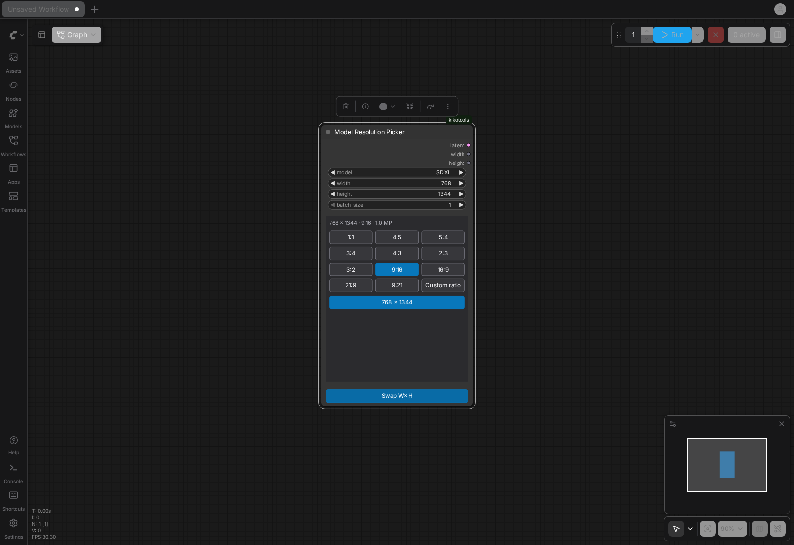

# Model Resolution Picker Documentation

## Overview

The Model Resolution Picker is a ComfyUI node that picks a model family and a size for it, then outputs an empty latent plus the width and height. A chip grid of aspect ratios and a size list under the active chip replace hunting through a long preset dropdown. The sizes come from each family's official lists or from megapixel tiers rounded to the family's grid step.



A light-theme capture is at `docs/screenshots/resolution-picker/ModelResolutionPicker-light.png`.

## Node Interface

- **Node id**: `ModelResolutionPicker`
- **Display name**: Model Resolution Picker
- **Category**: `🫶 ComfyAssets/🖼️ Resolution`

### Inputs
- **model**: Dropdown of the 14 shipped family labels (default `SDXL`)
- **resolution**: Dropdown of `custom` plus size labels such as `1216×832 - 3:2 (1.0MP)` (default `custom`); see [Resolution dropdown](#resolution-dropdown)
- **width**: Width in pixels (64-8192, step 8)
- **height**: Height in pixels (64-8192, step 8)
- **batch_size**: Number of empty latents (1-64)

### Outputs
- **latent**: Empty latent batch at the rounded size
- **width**: Rounded width (INT)
- **height**: Rounded height (INT)

A `resolution` label other than `custom` that parses as `W×H` takes precedence over width and height; `custom` or an unparseable label uses width and height. Width and height are rounded to the selected family's step at execution and never go below 64. An unknown family label (for example from an old workflow) falls back to step 8 and logs a warning.

The latent is the shared 4-channel 8x empty latent. It carries `downscale_ratio_spacial: 8`, which lets ComfyUI resize it for 16x and 32x VAEs, so the same output works with every family below.

The frontend reads the family table from `GET /kikotools/model_resolution/families`. The response carries the table, plus a `warnings` list that is empty unless an override file was ignored.

## Model Families

| Label | Models covered | VAE ratio | Step | Megapixel tiers | Default size | Group |
|---|---|---|---|---|---|---|
| SD 1.5 | SD 1.5 and SD 1.5 finetunes | 8x | 64 | 0.25, 0.5 | 512×512 | image |
| SDXL | SDXL, Pony and other SDXL finetunes | 8x | 64 | 1.0 | 1024×1024 | image |
| Illustrious XL | Illustrious XL v1.0 and later, NoobAI, WAI and other Illustrious finetunes | 8x | 32 | 1.0, 1.5, 2.25 | 1024×1024 | image |
| Anima | Anima | 8x | 16 | 0.5, 1.0, 1.5 | 1024×1024 | image |
| Flux.1 | Flux.1 dev / schnell / Krea, Chroma, HiDream I1, SD3.5, Lumina 2 | 8x | 16 | 0.5, 1.0, 1.5, 2.0 | 1024×1024 | image |
| Z-Image | Z-Image Turbo and Z-Image Base | 8x | 16 | 1.0, 1.6 | 1024×1024 | image |
| Qwen-Image | Qwen-Image and Qwen-Image 2512 | 8x | 16 | 1.76 | 1328×1328 | image |
| Flux.2 / Klein / MOSS | Flux.2 dev, Flux.2 Klein, Flux.3 Klein, MOSS-Image, Ideogram 4 | 16x | 16 | 1.0, 2.0, 4.0 | 1024×1024 | image |
| Qwen-Image 2.1 | Qwen-Image 2.1 and 2.1 Turbo | 16x | 32 | 1.0, 4.0 | 1024×1024 | image |
| HunyuanImage 2.1 | HunyuanImage 2.1 | 32x | 32 | 4.0 | 2048×2048 | image |
| Wan 2.2 (keyframes) | Wan 2.2 (first/last-frame sizes) | 16x | 16 | 0.4, 0.9 | 1280×720 | video |
| LTX-2 (keyframes) | LTX-2 (first/last-frame sizes) | 32x | 32 | 0.4, 0.9 | 768×512 | video |
| HunyuanVideo 1.5 (keyframes) | HunyuanVideo 1.5 (first/last-frame sizes) | 16x | 16 | 0.4, 0.9 | 1280×720 | video |
| MiniMax H3 (keyframes) | MiniMax H3 (first/last-frame sizes) | 16x | 32 | 0.4, 1.0 | 864×480 | video |

The family steps and megapixel tiers are the grid the node rounds to and the tiers custom ratios use. Video families are suffixed `(keyframes)`; see the keyframe note below.

## Family Table File

The families live in `kikotools/tools/model_resolution_picker/families.json`, loaded and checked by `table.py` when ComfyUI starts. A shipped file that fails the check is a startup error. Top-level keys:

- `version`: must be `1`
- `chips`: exactly the 11 chips listed above, in that order
- `mirror`: pairs every chip with its mirrored chip (`4:5` with `5:4`, `1:1` with itself)
- `default`: label or alias of the family selected by default
- `families`: a non-empty list of family objects

Each family object has:

- `label`: unique name shown in the dropdown; `aliases` (optional list) are old names that still resolve to it
- `models`: description string; `notes` (optional string) is ignored by the node
- `group`: `image` or `video`
- `vaeRatio`: `8`, `16` or `32`
- `step`: positive integer grid step (at most 4096)
- `megapixels`: non-empty list of tiers used by custom ratios (each above 0, at most 64)
- `default`: a `[width, height]` pair that appears in `sizes`
- `sizes`: an object with one key per chip, each a list of `[width, height]` pairs in ascending pixel order (an empty list disables the chip)

Every size must be a multiple of `step`, within 7% of its chip's ratio, listed under one chip only, and have its swapped size under the mirrored chip. `validate_table` returns every problem as text and never raises.

## User Override File

To change sizes without editing the shipped file, create `model_resolutions.json` in a `kikotools` folder inside ComfyUI's user directory (`folder_paths.get_user_directory()`; typically `ComfyUI/user/kikotools/model_resolutions.json`). It uses the same schema as the shipped file, and any top-level `chips` or `mirror` are ignored. Rules:

- Families are matched by `label`. A family with a shipped label replaces that family whole; a new label is appended after the shipped ones, in file order.
- `remove` is a list of labels that deletes shipped families. It wins over `families` when both name the same label.
- `default` is an optional label or alias that becomes the default family; it must name a family that survives the merge.
- The file is read again when its modification time changes, so a page reload (or ComfyUI's "Refresh node definitions") picks up edits, including the `model` dropdown, without restarting ComfyUI.
- The shipped file is never modified.

This example replaces SDXL with a shorter list, adds a new family, hides two shipped ones and makes the new family the default:

```json
{
  "version": 1,
  "default": "My SDXL",
  "remove": ["SD 1.5", "Anima"],
  "families": [
    {
      "label": "SDXL",
      "aliases": [],
      "models": "SDXL with a trimmed size list",
      "group": "image",
      "vaeRatio": 8,
      "step": 64,
      "megapixels": [1.0],
      "default": [1024, 1024],
      "sizes": {
        "1:1": [[1024, 1024]],
        "4:5": [[832, 1024]],
        "5:4": [[1024, 832]],
        "3:4": [], "4:3": [], "2:3": [], "3:2": [],
        "9:16": [], "16:9": [], "21:9": [], "9:21": []
      }
    },
    {
      "label": "My SDXL",
      "aliases": ["my-sdxl"],
      "models": "My own SDXL finetune",
      "group": "image",
      "vaeRatio": 8,
      "step": 64,
      "megapixels": [1.0],
      "default": [1152, 896],
      "sizes": {
        "1:1": [[1024, 1024]],
        "4:5": [[896, 1152]], "5:4": [[1152, 896]],
        "3:4": [], "4:3": [], "2:3": [], "3:2": [],
        "9:16": [], "16:9": [], "21:9": [], "9:21": []
      }
    }
  ]
}
```

The merged table is checked with the same `validate_table`. If the file is unreadable, is not valid JSON, nests too deeply, or fails the check, the whole file is ignored and the shipped table is used. ComfyUI logs a warning `Override ignored: <path>: <reason>`, the same text is returned in the `warnings` list of `GET /kikotools/model_resolution/families`, and the panel's status line shows the first warning. Fix the file and reload to clear it.

## How to Use

### Chips and size list
1. **Pick a model** in the dropdown.
2. **Click a ratio chip** (`1:1 4:5 5:4 3:4 4:3 2:3 3:2 9:16 16:9 21:9 9:21`; each shows a small outline of its shape). The size list under the active chip shows that family's sizes for the ratio.
3. **Click a size** to write it to width and height. The header shows `W × H · ratio · MP` for the current values.

A chip is disabled when the family lists no sizes for that ratio.

### Resolution dropdown
The native `resolution` dropdown sits between `model` and `width` and mirrors the panel. Its options are `custom` plus every size label from the shipped families (sorted as text), written `{w}×{h} - {ratio} ({mp}MP)` with 1 MP = 1,048,576 pixels, for example `1216×832 - 3:2 (1.0MP)`.

- In the UI the dropdown lists the sizes of the active ratio chip, or every size of the family when `Custom ratio` is active or no chip matches.
- Picking a label writes width and height and activates the matching chip.
- Clicking a chip or a size, or swapping, sets the label to match.
- Typing a size that is not in the list, wiring width or height, a families table that is still loading, or a failed load shows `custom`.
- On execution a non-`custom` label that parses wins over width and height; `custom` or an unparseable label uses width and height. Labels that only an override file adds are accepted too.

### Swap
The Swap W×H button (the same control Width Height Selector and Empty Latent Batch use) exchanges width and height and lands on the mirrored chip, for example 3:4 becomes 4:3.

### Changing the model
Switching the model keeps the current size if the new family lists it. Otherwise it falls back to the active chip's default size in the new family, then to the family default.

### Custom ratio
Choose the `Custom ratio` chip and type a ratio such as `16:9`. The panel computes sizes at the family's megapixel tiers, rounded to the family's step. Bad input is rejected with "Enter a ratio like 16:9".

### Custom resolution
Type width and height directly in the native widgets. The panel re-derives its chip, list and header from those values. They are rounded to the family's step when the node runs.

### Wired-in width or height
When width or height is driven by another node, the panel and Swap are disabled.

### Sizes unavailable
If the families route fails, the panel shows "Sizes unavailable; type width and height" with the chips disabled. The node still works through the native widgets.

Panel state is derived from the native widgets, so nothing extra is saved in the workflow. New nodes start at 340 × 600.

## Keyframe Note for Video Families

`Wan 2.2`, `LTX-2`, `HunyuanVideo 1.5` and `MiniMax H3` (all suffixed `(keyframes)`) are listed for first/last-frame generation at the video model's frame size. The latent output is still an image latent and is never fed to a video model. The image latent decodes to the listed size when the keyframe image model's VAE ratio divides the video family's step (for example an 8x or 16x image model for Wan 2.2's 1280×720; a 32x model would not land on 720).

## Manual GPU Check Before Merge

The real-host CI never queues a generation, so the latent path is only unit-tested. Core `EmptyLatentImage` is the same 4-channel, 8x, marked latent this node emits, and the official Anima template already runs that path (channel repeat 4 → 16). Confirm two cases by hand on a GPU box. Each is one queued image through this node → KSampler → VAE Decode → Save:

1. `Flux.2 / Klein / MOSS` (16x) at 1248×832.
2. `HunyuanImage 2.1` (32x) at 2560×1536.

For each case, the saved PNG's dimensions must equal the node's width and height outputs. Record both results in the PR description.

## Related Nodes

- [Width Height Selector](width_height_selector.md): preset-based dimensions with swap
- [Empty Latent Batch](empty_latent_batch.md): empty latent batches with presets
